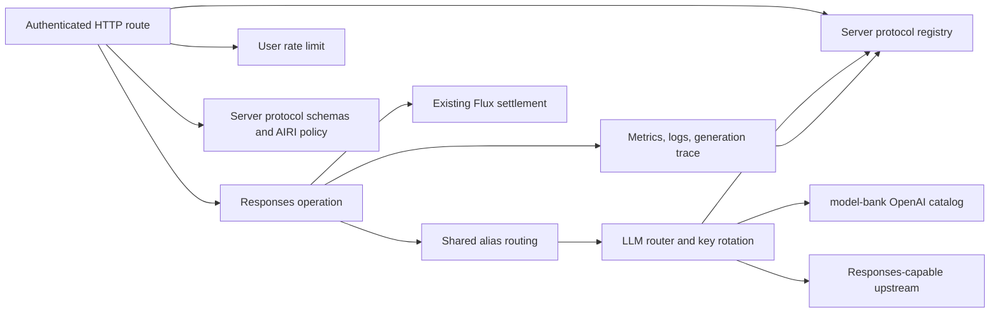
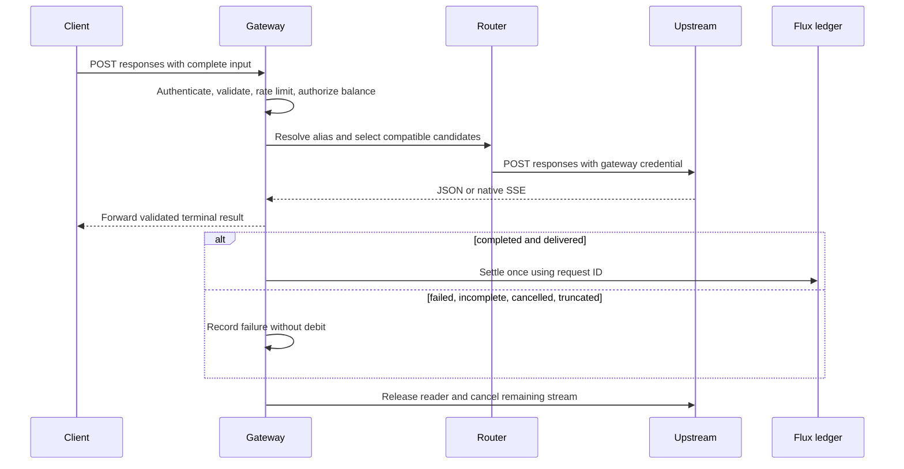

<a id="hosted-responses-gateway"></a>

# Cổng hosted Responses

Trạng thái: đã chấp nhận

<a id="decision-and-scope"></a>

## Quyết định và phạm vi

Người dùng đã xác nhận phạm vi triển khai này và trình phân tích cú pháp `@xsai/shared-stream` hiện có.

Vấn đề #2479 xác định điểm cuối tạo Responses không trạng thái, được xác thực. PR này triển khai ranh giới máy chủ của nó trên cổng hiện có và chính sách Flux. Khách hàng gửi các Mục đầu vào hoàn chỉnh. Cổng buộc `store: false`. Nó từ chối các tham chiếu hội thoại, ID tệp, thực thi nền và các công cụ hosted ngoài tìm kiếm trên web. Sau khi xác thực, điểm cuối Responses chấp nhận nội dung yêu cầu 40 MiB để một tệp nội tuyến có kích thước tối đa phù hợp với phong bì JSON của nó. API route khác giữ mặc định 1 MiB. Yêu cầu lớn hơn phải sử dụng URL từ xa hoặc tải trọng nhỏ hơn. Người dùng đã xác nhận hỗ trợ tìm kiếm trên web native cho các phiên bản ngược dòng của OpenAI. Máy chủ sử dụng lại khả năng tìm kiếm `model-bank/openai` cho các luồng ngược dòng OpenAI trực tiếp. Điểm cuối OpenRouter chuẩn sử dụng công cụ máy chủ Responses của nó và ánh xạ tên công cụ trung tính nhà cung cấp tại ranh giới bộ điều hợp. Các điểm cuối tương thích khác không quảng cáo khả năng nhà cung cấp này. Yêu cầu chọn tham gia tìm kiếm thông qua `tools`; cổng không tiêm công cụ. Cuộc gọi tìm kiếm và nguồn vẫn là các mục đầu vào di động. Các đề xuất tìm kiếm không được hỗ trợ sẽ bị bỏ qua.

Các công cụ chức năng chạy trên máy khách và trả về kết quả đầu ra của chúng trong yêu cầu tiếp theo. Mỗi công cụ chức năng phải bao gồm một lược đồ tham số đối tượng. Các mục `required` của nó phải đặt tên cho các thuộc tính được khai báo. Lựa chọn công cụ chỉ có thể tham khảo các công cụ được khai báo trong cùng một yêu cầu. Một lựa chọn `allowed_tools` chứa tối đa 128 tài liệu tham khảo.

Mỗi upstream chọn tham gia Responses thông qua `protocols: ['responses']` một cách rõ ràng. Danh sách bị bỏ qua chỉ hỗ trợ Chat Completions. Điều này bảo tồn hợp đồng dịch vụ được cấu hình hiện tại. Bí danh giữ thứ tự chính và phương án dự phòng của chúng. Tính năng lọc tương thích đi trước lựa chọn có trọng số để route không được hỗ trợ không làm lệch lưu lượng truy cập. Các ứng viên không được hỗ trợ sẽ không bao giờ nhận được yêu cầu. Lỗi HTTP được thử lần cuối vẫn hiển thị cho người gọi. Việc lưu giữ này chỉ áp dụng khi ứng viên sau này thiếu giao thức hoặc hỗ trợ tìm kiếm. Các lỗi định tuyến khác thay thế phản hồi HTTP trước đó.

Thay đổi này duy trì chính sách Flux hiện có và không thêm tỷ lệ cho mỗi lần tìm kiếm. Dịch vụ này tính phí cuộc gọi tìm kiếm upstream; nội dung tìm kiếm trả về token sử dụng tỷ lệ token hiện có.

Mỗi yêu cầu sở hữu một hóa đơn ID. Các kết quả đã hoàn thành sử dụng cách sử dụng input/output token và chính sách giá Flux hiện có. Việc thiếu sử dụng tuân theo chính sách tỷ lệ cố định hiện có. Các luồng không thành công, không đầy đủ, bị hủy và bị cắt bớt sẽ không bị ghi nợ. Kết quả truyền dữ liệu liên tục chỉ có thể được tính phí sau khi một sự kiện đầu cuối được xác thực đến được người viết downstream. Kết quả JSON ổn định sau khi xác thực nội dung và trước khi phản hồi HTTP trả về. Hủy trước thời điểm đó sẽ thắng. Sự kiện thiết bị đầu cuối trùng lặp không thể tính phí lại. Cổng dừng đọc sau sự kiện đầu cuối và giải phóng tài nguyên upstream. Số liệu, nhật ký yêu cầu và sinh nội dung ghi lại các lỗi thiết bị đầu cuối cũng như các yêu cầu thành công.

OpenRouter có thể gắn nhãn các khung Responses SSE bằng tên `event` chung hoặc không khớp. Chỉ dành cho nhà cung cấp này, cổng xác thực tải trọng JSON và chuyển tiếp tải trọng `type` làm tên sự kiện. Các loại tải trọng chứa dòng xuống dòng hoặc nguồn cấp dữ liệu dòng không hợp lệ và không thể trở thành trường SSE. nhà cung cấp khác vẫn duy trì việc khớp tên sự kiện một cách nghiêm ngặt. OpenRouter cũng có thể bỏ qua sự kiện đầu cuối sau khi mọi mục đầu ra được khai báo hoàn thành theo thứ tự. Sau đó, cổng tổng hợp `response.completed` từ phản hồi được xác thực và các mục đã hoàn thành. Chỉ kết quả thiết bị đầu cuối được chuyển tiếp mới cho phép thanh toán; các luồng không đúng định dạng, không đầy đủ hoặc mơ hồ vẫn chưa được lập hóa đơn.

Không có cấu hình sản xuất, triển khai, di chuyển cơ sở dữ liệu hoặc thay đổi giao thức máy khách mặc định nào thuộc về PR này. Bộ chuyển đổi nhà cung cấp chính thức và việc chấp nhận trực tiếp Flux vẫn giải phóng các tác vụ theo #2479. Không có mức giá mới, đặt trước thanh toán, phiên thời gian thực hoặc dịch vụ tìm kiếm nào được giới thiệu.

<a id="protocol-ownership"></a>

## Quyền sở hữu giao thức

Người dùng đã xác nhận việc hợp nhất giao thức chỉ dành cho máy chủ. Giá trị giao thức máy khách không thay đổi. Sổ đăng ký giao thức máy chủ sở hữu số nhận dạng và HTTP tạo đường dẫn. Tên hoạt động có nguồn gốc là `<protocol>.create`. Xác thực cấu hình, khóa thao tác cổng, định tuyến và theo dõi sẽ sử dụng sổ đăng ký đó. Mỗi bộ điều hợp giao thức sở hữu tuần tự hóa yêu cầu, xác thực và tính đủ điều kiện tìm kiếm native. Cổng duy trì vòng đời phản hồi theo giao thức cụ thể cũng như ranh giới thanh toán và đo từ xa được chia sẻ. Việc thêm giao thức yêu cầu phải có bộ chuyển đổi và hợp đồng đầu vào cổng; các giá trị không được hỗ trợ không bao giờ chọn Trò chuyện một cách ngầm định. Tin nhắn API không được triển khai hoặc quảng cáo bởi thay đổi này.

Người dùng đã yêu cầu căn chỉnh cho phù hợp với ranh giới gói hiện có của xsai. Các gói sinh nội dung của nó xuất các hợp đồng TypeScript, không hoàn thành các trình xác nhận yêu cầu chuyển khoản. `xsschema` xác thực các lược đồ do người gọi cung cấp; nó không sở hữu hợp đồng yêu cầu nhà cung cấp. Do đó, máy chủ sở hữu các lược đồ Valibot có thể tái sử dụng trong `services/adapters/llm/schemas`. Các định nghĩa OpenResponses đã tạo và các tiện ích mở rộng OpenAI tách biệt với các hạn chế về tài khoản dùng chung của AIRI. Không có xuất lược đồ hoặc ngang hàng Valibot nào được thêm vào xsai. Bản vá máy khách hiện có vẫn không thay đổi.

<a id="module-dependencies"></a>

## Phần phụ thuộc của mô-đun



<a id="affected-files"></a>

## Các tập tin bị ảnh hưởng

```text
backend/
  apps/api/
    README.md
    package.json
    src/{app.ts,app.test.ts}
    src/middlewares/rate-limit.ts
    src/routes/openai/v1/
      index.ts, gateway.ts, model-routing.ts, route.test.ts
      middlewares/{telemetry.ts,telemetry.test.ts}
      operations/chat-completions/index.ts
      operations/responses/{index.ts,request.ts,request.test.ts}
    src/services/
      adapters/config-kv/definitions.ts
      domain/llm-router/{router.ts,types.ts,tests/router.test.ts}
      domain/llm-tracing/{index.ts,index.test.ts}
      adapters/llm/{index.ts,chat-completions.ts,responses.ts,types.ts}
      adapters/llm/schemas/{responses.ts,openresponses-schema.ts,request-openapi.json,README.md}
    src/schemas/{generation-protocol.ts,generation-protocol.test.ts}
  docs/ai/adr/2026-09-15-hosted-responses.md
```

<a id="request-lifecycle"></a>

## Yêu cầu vòng đời



<a id="verification"></a>

## Xác minh

Kiểm thử route đã gắn với xác thực, dữ liệu sai định dạng, tham chiếu có trạng thái, công cụ tìm kiếm, công cụ hosted bị từ chối và số dư Flux không đủ. Kiểm tra khớp mô hình theo danh mục, từ chối proxy tương thích, dự phòng theo nhóm, Items tìm kiếm dùng được giữa các hệ thống, trích dẫn và lựa chọn công cụ được giữ nguyên. Kiểm tra hoàn tất JSON/SSE, mức sử dụng, lỗi upstream, khung UTF-8 bị chia nhỏ, hủy tác vụ, sự kiện kết thúc trùng và EOF của luồng. Kiểm tra chuẩn hóa tên sự kiện OpenRouter, từ chối ngắt dòng, khôi phục EOF đúng thứ tự và chỉ quyết toán sau khi đã gửi khung kết thúc được chuẩn hóa hoặc tổng hợp. Kiểm tra định tuyến theo nhóm và không theo nhóm, ứng viên không tương thích, chuyển khóa dự phòng và bảo toàn lỗi kết thúc từ upstream. Chạy các kiểm thử tập trung cho gateway, router, schema và thanh toán. CI kiểm tra toàn repo.

<a id="references"></a>

## Tài liệu tham khảo

- Phạm vi máy chủ [, Sự cố #2479](https://github.com/moeru-ai/airi/issues/2479)
- [OpenAI Responses truyền dữ liệu liên tục sự kiện](https://platform.openai.com/docs/api-reference/responses-streaming)
- [Bộ điều hợp máy khách được hợp nhất, PR #2477](https://github.com/moeru-ai/airi/pull/2477)
