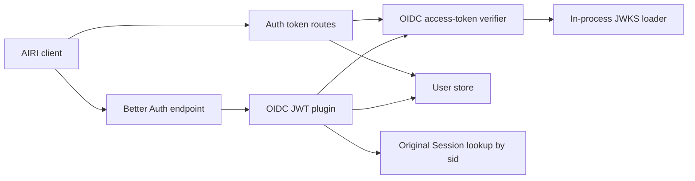
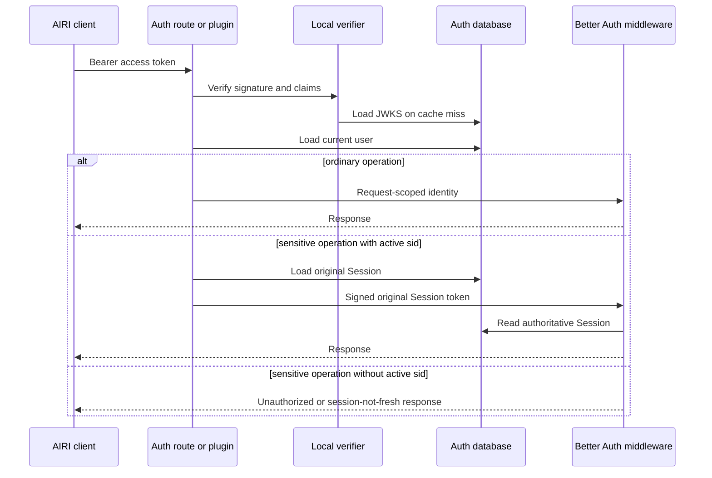

<a id="oidc-jwt-identity-at-the-better-auth-boundary"></a>

# Danh tính OIDC JWT tại ranh giới Better Auth

Trạng thái: đã chấp nhận

<a id="context"></a>

## Bối cảnh

Dịch vụ Auth cấp quyền truy cập OIDC token cho máy khách AIRI. Những khách hàng này cũng gọi hồ sơ Better Auth và các điểm cuối tài khoản với quyền truy cập token.

Phần mềm trung gian phiên Better Auth chấp nhận định dạng cookie phiên của nó. Nó không chấp nhận quyền truy cập JWT không đối xứng token từ plugin OAuth nhà cung cấp.

Cầu nối hiện có xác minh từng JWT và tạo Phiên cơ sở dữ liệu. Sau đó, nó sẽ chèn Phiên token mới làm cookie yêu cầu. Do đó, việc thăm dò phiên khách hàng có thể tạo một hàng cơ sở dữ liệu cho mỗi yêu cầu. PostgreSQL không xóa hàng khi `expires_at` đi qua.

`/get-session` và `/list-sessions` route tùy chỉnh cũng gọi Better Auth trước trình xác minh JWT trực tiếp của họ. Lệnh này gọi cầu nối trên đường dẫn xác thực nóng nhất. Trình xác minh của họ cũng tìm nạp điểm cuối JWKS công khai của dịch vụ này qua loopback HTTP.

<a id="decision"></a>

## Phán quyết

Sử dụng một trình xác minh truy cập cục bộ-token cho Auth route và plugin Better Auth. Trình xác minh tải dữ liệu JWKS đang xử lý và lưu bộ khóa vào bộ nhớ đệm trong 60 giây. Nó xác nhận các xác nhận quyền sở hữu JWT đã được xác minh bằng Valibot.

Áp dụng thay đổi trong hai yêu cầu kéo xếp chồng lên nhau:

1. token route tùy chỉnh xác thực JWT trước khi tra cứu phiên Better Auth.
2. Plugin cung cấp danh tính đã được xác minh thông qua ngữ cảnh yêu cầu. Nó không tạo ra một hàng Phiên.

Plugin cuối cùng coi JWT là thông tin xác thực cho các hoạt động thông thường. Nếu token chứa `sid` gốc đang hoạt động, plugin sẽ cung cấp Phiên token đó cho phần mềm trung gian có thẩm quyền của Better Auth. Các hoạt động nhạy cảm và phiên mới yêu cầu Phiên hoạt động này.

OAuth nhà cung cấp bao gồm `sid` trong quyền truy cập token được tạo từ Phiên đăng nhập đang hoạt động. token được làm mới có thể bỏ qua `sid` sau khi Phiên đó hết hạn hoặc bị xóa. token như vậy vẫn có hiệu lực đối với các hoạt động thông thường cho đến `exp`, nhưng nó không thể ủy quyền cho một hoạt động nhạy cảm.

<a id="scope"></a>

## Phạm vi

- Dịch vụ xác thực quyền truy cập OIDC-Xác thực token
- Xác thực tùy chỉnh token route
- Nhận dạng yêu cầu Better Auth
- Hành vi phiên nhạy cảm Better Auth
- Kiểm tra lệnh cấm tài khoản đối với người gọi JWT

<a id="non-goals"></a>

## Ngoài phạm vi

- Xóa các hàng Phiên đã hết hạn trong lịch sử
- Thay đổi thời gian truy cập-token hoặc làm mới-token
- Thay đổi bảng cơ sở dữ liệu OAuth nhà cung cấp
- Thay thế Better Auth hoặc plugin OAuth nhà cung cấp của nó
- Thay đổi xác thực tài nguyên API

<a id="consequences"></a>

## Hậu quả

- Các yêu cầu JWT bình thường không tạo các hàng Phiên.
- Xác minh JWT không gọi dịch vụ qua vòng lặp HTTP.
- Xoay phím đến từng người xác minh trong vòng 60 giây.
- Các yêu cầu JWT thông thường vẫn tải người dùng hiện tại về trạng thái xóa và cấm.
- Các hoạt động nhạy cảm giữ lại việc thu hồi Phiên và kiểm tra độ mới.
- Các hàng đã hết hạn hiện tại cần có kế hoạch dọn dẹp sản xuất riêng.

<a id="module-dependencies"></a>

## Phần phụ thuộc của mô-đun



<a id="affected-files"></a>

## Các tập tin bị ảnh hưởng

```text
backend/
  apps/auth/src/
    auth.ts
    oidc-access-token.ts
    routes.ts
    plugins/oidc-jwt-bearer.ts
    tests/
      oidc-jwt-bearer.test.ts
      routes-oidc-token-auth.test.ts
  docs/ai/adr/
    2026-09-20-oidc-jwt-session-boundary.md
```

<a id="request-sequence"></a>

## Trình tự yêu cầu



<a id="test-plan"></a>

## kế hoạch kiểm tra

- Đảm bảo rằng JWT route hợp lệ không gọi tra cứu phiên Better Auth.
- Đảm bảo rằng các JWT không hợp lệ giữ lại Better Auth phương án dự phòng.
- Đảm bảo rằng các xác nhận quyền sở hữu không hợp lệ không tạo ra danh tính yêu cầu.
- Đảm bảo rằng plugin không bao giờ gọi `createSession`.
- Đảm bảo rằng `sid` đang hoạt động cung cấp cookie Phiên gốc.
- Đảm bảo rằng `sid` đã hết hạn không thể cung cấp cookie Phiên.
- Đảm bảo rằng người dùng bị cấm không nhận được danh tính yêu cầu.
- Chạy kiểm tra Auth, Auth kiểm tra kiểu dữ liệu, lint kho lưu trữ và CI.
