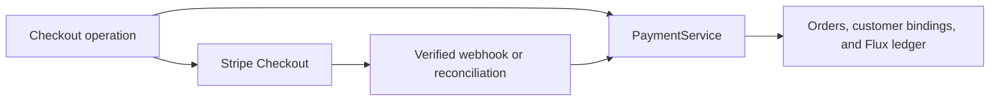
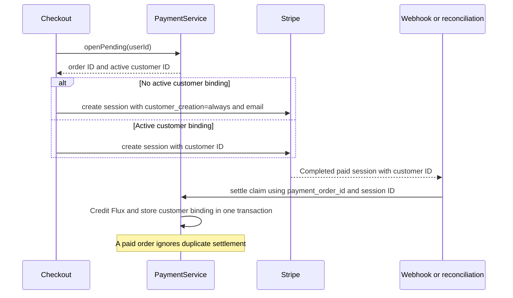

<a id="stripe-checkout-customer-creation"></a>

# Tạo khách hàng Stripe Checkout

Trạng thái: đã chấp nhận. Người yêu cầu xác nhận việc tạo khách hàng cho người dùng không bị ràng buộc và tái sử dụng cho người dùng bị ràng buộc.

<a id="decision"></a>

## Phán quyết

Đối với người dùng không có ràng buộc khách hàng Stripe đang hoạt động, Checkout sẽ gửi `customer_creation: 'always'` và email người dùng. Đối với người dùng có ràng buộc, Checkout sẽ gửi `customer` ID hiện có và bỏ qua tùy chọn tạo cũng như email.

Stripe mặc định tạo khách hàng có điều kiện để thanh toán một lần. Chỉ riêng một email không yêu cầu đối tượng Khách hàng hoặc chọn Khách hàng hiện có. Xem thông số [Stripe Checkout](https://docs.stripe.com/api/checkout/sessions/create#checkout_session_create-customer_creation).

Hiện tại giải quyết store khách hàng trả lại ID trong `payment_customer` khi nó credit đặt hàng. Lần kiểm tra tiếp theo sẽ đọc ràng buộc này thông qua `PaymentService.openPending`. Đơn đặt hàng cục bộ đã liên kết thanh toán với người dùng. Việc tạo khách hàng sẽ bổ sung danh tính lâu dài trong Stripe.

<a id="scope-and-non-goals"></a>

## Phạm vi và ngoài phạm vi

Thay đổi này cập nhật các tham số Checkout và phạm vi hồi quy. Nó không yêu cầu di chuyển cơ sở dữ liệu hoặc thay đổi hợp đồng HTTP. Nó không lấp đầy các đơn đặt hàng lịch sử, lưu phương thức thanh toán, thay đổi các khoản trợ cấp Flux hoặc triển khai dịch vụ. Việc thanh toán đồng thời trước lần ràng buộc đầu tiên có thể tạo ra nhiều khách hàng của Stripe. Thay đổi này không tuần tự hóa việc tạo thanh toán. Khách hàng của Stripe lịch sử không có ràng buộc cục bộ sẽ không được khớp qua email.

<a id="dependencies-and-affected-files"></a>

## Các phần phụ thuộc và các tập tin bị ảnh hưởng



```text
backend/
  apps/api/src/routes/stripe/operations/checkout.ts
  apps/api/src/routes/stripe/checkout.test.ts
  docs/ai/adr/2026-09-29-stripe-checkout-customer.md
```

<a id="payment-sequence"></a>

## Trình tự thanh toán



<a id="test-plan"></a>

## kế hoạch kiểm tra

- Yêu cầu khách hàng tạo khi không có ràng buộc hoạt động nào tồn tại, bao gồm cả ràng buộc đã xóa.
- Giải quyết một phiên trả phí thông qua dịch vụ thanh toán và ánh xạ hóa đơn hiện có.
- Xác minh ràng buộc khách hàng, số dư Flux và hành vi thanh toán trùng lặp.
- Xác minh rằng lần thanh toán tiếp theo sẽ sử dụng lại khách hàng đã lưu mà không cần tạo hoặc tham số email.
- Chạy thử nghiệm Stripe và thanh toán, API kiểm tra kiểu dữ liệu và tìm lỗi mã nguồn kho lưu trữ.
- mock Sọc ở ranh giới SDK của nó. Việc thanh toán Stripe thực sự vẫn nằm ngoài phạm vi kiểm tra tự động.
