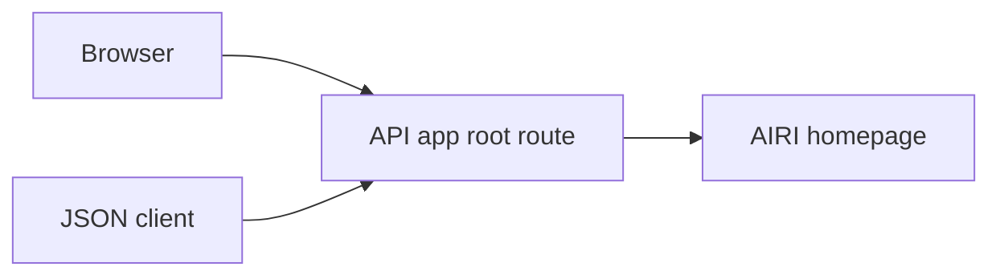
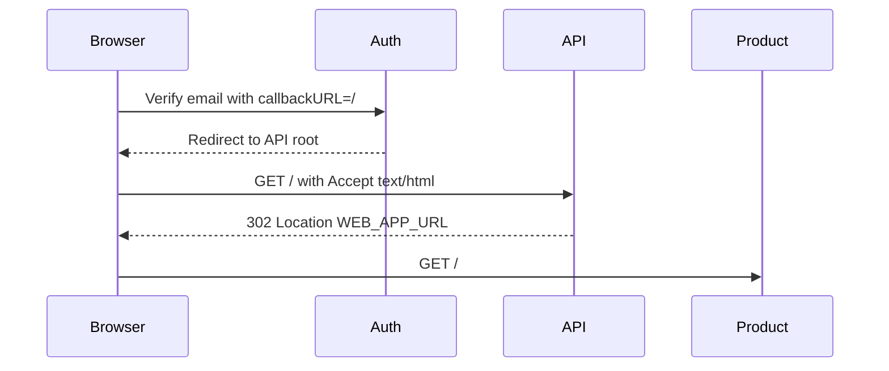

<a id="api-root-browser-redirect"></a>

# Chuyển hướng trình duyệt gốc API

Trạng thái: đã chấp nhận

<a id="decision"></a>

## Phán quyết

Trình duyệt GET và HEAD yêu cầu chuyển hướng gốc API sang `WEB_APP_URL` đã định cấu hình với trạng thái 302. Yêu cầu phải chấp nhận rõ ràng `text/html` với chất lượng tích cực. Hono phân tích phạm vi phương tiện; các khách hàng khác giữ lại danh tính dịch vụ JSON. Phản hồi thay đổi tùy theo `Accept`. Chính sách no-store hiện tại vẫn hoạt động. Mục tiêu đến từ cấu hình máy chủ, không bao giờ đến từ yêu cầu. Truy vấn yêu cầu không được chuyển tiếp.

<a id="scope"></a>

## Phạm vi

Liên kết xác minh email với `callbackURL=/` sẽ đưa trình duyệt về gốc API. Root hiện tại trả về JSON, khiến người dùng ở bên ngoài sản phẩm. Thay đổi này xác định gốc API làm điểm truy cập sản phẩm cho khách truy cập trình duyệt.

ngoài phạm vi: xử lý email token, gọi lại xác thực, trạng thái OIDC, tài khoản các thay đổi trạng thái và API route khác. Chuyển hướng không thiết lập hoặc xác nhận phiên đăng nhập hoặc trạng thái xác minh email.

<a id="module-dependencies"></a>

## Phần phụ thuộc của mô-đun



<a id="affected-files"></a>

## Các tập tin bị ảnh hưởng

```text
backend/api/src/
  app.ts
  app.test.ts
```

<a id="sequence"></a>

## Sự liên tiếp



<a id="test-plan"></a>

## kế hoạch kiểm tra

Chạy thử nghiệm ứng dụng API trước và sau khi thay đổi. Kiểm tra chuyển hướng GET và HEAD, đích được định cấu hình mà không có truy vấn được chuyển tiếp, JSON Responses, đường dẫn không xác định, yêu cầu POST và tình trạng route. Chạy API kiểm tra kiểu dữ liệu, kiểm tra lỗi mã nguồn và lỗi khác. Việc chấp nhận sản xuất yêu cầu triển khai và luồng xác minh email mới.
