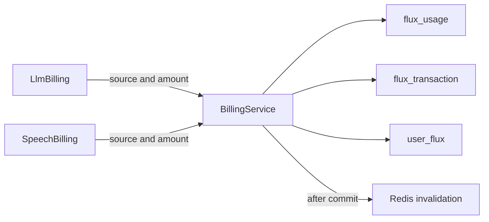
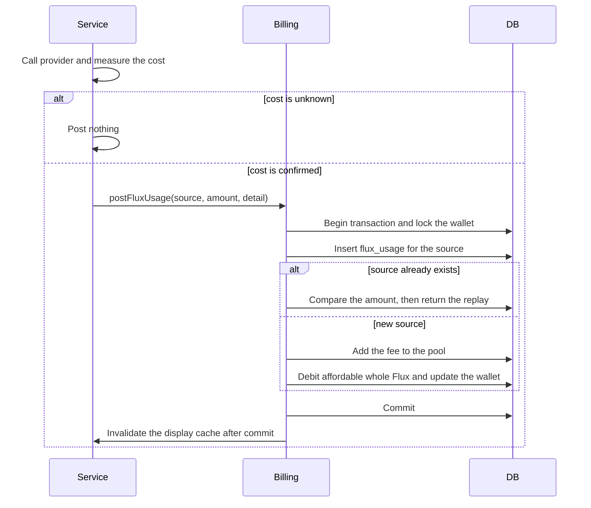

<a id="flux-usage-records-and-pooled-settlement"></a>

# Hồ sơ sử dụng Flux và giải quyết gộp

Trạng thái: đã chấp nhận

<a id="decision"></a>

## Phán quyết

Ví chấp nhận `postFluxUsage({ userId, source: { type, id }, amountMicroFlux, detail? })`. Hợp đồng không chứa mô hình, lượt, lần thử, giá cả, nhà cung cấp hoặc trạng thái chờ xử lý. `flux_usage` store một khoản phí micro-Flux được xác nhận cho mỗi nguồn. Các hàng chỉ được thêm vào. `flux_transaction` store chỉ thay đổi số dư số nguyên. Cột `pool` của nó đặt tên cho bucket mà các cột cân bằng mô tả. `user_flux.unsettled_micro_flux` store nhóm nổi bật được chia sẻ. `user_flux` cũng có Capacitor thanh toán trước khi mua Flux. Xem [the Capacitor ADR](./2026-10-04-subscription-credits.md). Một Flux bằng 1.000.000 micro-Flux. Một dịch vụ đưa bằng chứng của riêng mình vào `detail`. Một dịch vụ mới cần `source.type` mới và không có bảng mới.

<a id="boundary"></a>

## ranh giới

```text
llm_request_attempt -> llm_request_log        evidence about what the provider did
                              |
                      (same request ID, no foreign key)
                              v
                         flux_usage           what this request cost in micro-Flux
                              |
                              v  (pooled settlement)
                       flux_transaction       integer balance changes
```

Nhật ký yêu cầu giữ giá nhà cung cấp và không bao giờ chuyển đổi nó thành Flux. Thanh toán chuyển đổi chi phí đã xác nhận thành micro-Flux với giá từ chính sách được ủy quyền. Thanh toán không đọc nhật ký yêu cầu. route cung cấp cho nó khả năng sử dụng trong bộ nhớ. Việc ghi nhật ký không thành công không thể chặn việc thanh toán. Việc ghi hóa đơn không thành công không thể chặn nhật ký.

<a id="scope"></a>

## Phạm vi

Thêm `flux_usage` và `user_flux.unsettled_micro_flux`. Dừng viết `llm_request_settlement`. Loại bỏ bộ đếm ký tự lời nói của Redis. Loại bỏ `FluxMeter`. LLM và bài phát biểu thanh toán thông qua cùng một lệnh. credit giải quyết các khoản phí còn tồn đọng phải chăng. Các điều chỉnh của quản trị viên sẽ bảo toàn các khoản phí chưa thanh toán.

<a id="non-goals"></a>

## Ngoài phạm vi

Đặt trước vé vào cửa, tự động đối chiếu các yêu cầu chưa được lập hóa đơn, hoàn tiền và định giá lại lịch sử.

<a id="invariants"></a>

## Bất biến

Danh tính nguồn là duy nhất cho mỗi ví, bao gồm số tiền bằng 0. Một nguồn trùng lặp với số lượng khác nhau không thành công. Một bản phát lại giống hệt nhau không bao giờ đăng hai lần. Một giao dịch ghi lại bản ghi sử dụng, ghi nợ số nguyên và ảnh chụp nhanh ví. Một khoản ghi nợ làm giảm nhóm theo số nguyên của nó nhân với 1.000.000. Tổng của tất cả các khoản phí bằng Flux được ghi nợ nhân với 1.000.000 cộng với số tiền chưa thanh toán. Kế toán không phụ thuộc vào nhật ký yêu cầu. Phát lại chỉ đọc `flux_usage`.

<a id="unbilled-requests"></a>

## Yêu cầu chưa được thanh toán

Một chi phí không xác định được đăng bài miễn phí. Nhật ký yêu cầu giữ bằng chứng. Yêu cầu có hàng nhật ký và không có hàng `flux_usage` sẽ không được lập hóa đơn. Nối hai bảng theo yêu cầu ID để tìm các yêu cầu này. Chi phí chưa biết sẽ không được định giá sau này bằng giá gốc. Hòa giải sử dụng giá tại thời điểm đó.

<a id="module-graph"></a>

## Biểu đồ mô-đun



<a id="affected-files"></a>

## Các tập tin bị ảnh hưởng

```text
backend/api/
  drizzle/0028_flux_usage.sql
  src/schemas/{flux,flux-usage}.ts
  src/services/domain/billing/{billing-service,flux-posting,llm-billing,speech-billing}.ts
  src/services/domain/{flux,flux-cache,flux-transaction}.ts
  src/routes/{flux,openai/v1,audio-speech-ws}/
  src/app.ts
```

<a id="posting-sequence"></a>

## Trình tự đăng bài



<a id="migration-and-rollout"></a>

## Di chuyển và triển khai

Migration 0028 tạo `flux_usage` và thêm `user_flux.unsettled_micro_flux`. Migration không thay đổi `flux_transaction` hoặc `llm_request_settlement`. Các bản ghi lịch sử được giữ nguyên. Migration 0030 xóa `llm_request_settlement` và `llm_request_log.flux_consumed`. Cột sổ cái `flux_transaction.settlement_id` giữ giá trị nhưng không còn liên kết đến bản ghi. Xuất dữ liệu quyết toán lịch sử trước khi chạy migration 0030. Không thể đảo ngược thao tác xóa. Nhật ký yêu cầu không còn lưu số Flux. Chỉ số và thuộc tính span `flux_consumed` báo phí bằng Flux. API áp dụng migration khi khởi động. Dừng các tiến trình API ghi dữ liệu cũ trước khi chạy phiên bản mới. Không hỗ trợ chạy đồng thời tiến trình ghi cũ và mới. Không nhập bộ đếm giọng nói Redis. Cơ chế tính phí cũ bỏ qua phần dư dưới một Flux cho mỗi người dùng. Tác vụ này không chạy migration hoặc triển khai trên môi trường production.

<a id="verification"></a>

## Xác minh

Chạy thử nghiệm dịch vụ và bộ thử nghiệm API đầy đủ. Chạy thử nghiệm đồng thời dựa trên cơ sở dữ liệu PostgreSQL cục bộ có nhiều kết nối và sự kiện trùng lặp. Chạy thử nghiệm di chuyển với các tệp SQL thực tế. Nó kiểm tra xem các hàng lịch sử có thay đổi không. Kiểm tra tính bất biến bảo toàn sau các hoạt động hỗn hợp LLM, lời nói, credit và quản trị viên. Chạy API kiểm tra kiểu dữ liệu và root lint.
