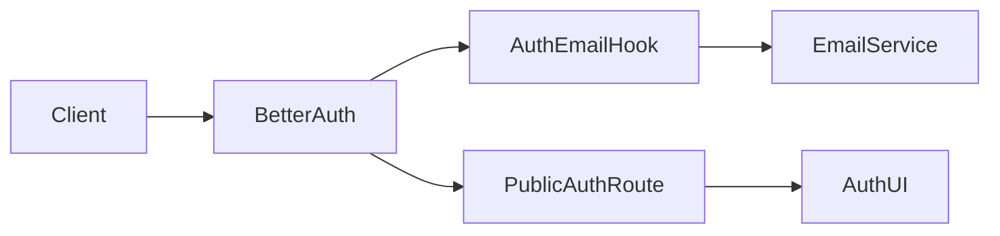
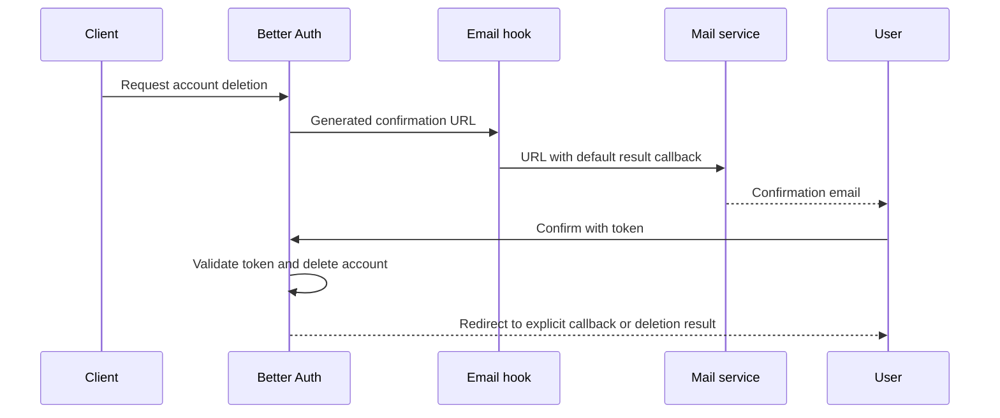
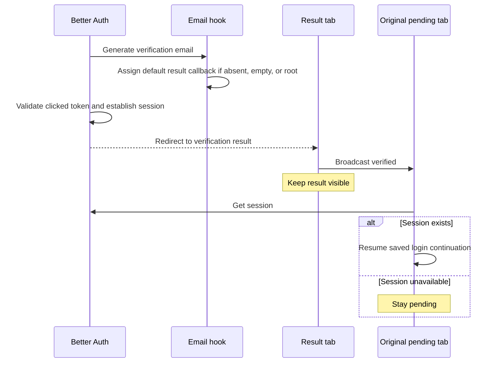

<a id="account-email-confirmation-results"></a>

# Kết quả xác nhận email tài khoản

Trạng thái: đã chấp nhận

<a id="context-and-decision"></a>

## Bối cảnh và quyết định

Một email xóa `callbackURL=/` sẽ hoàn tất thao tác, sau đó gửi người dùng đến thư mục gốc API mà không có thông báo kết quả. Dịch vụ xác thực sở hữu đích kết quả mặc định là hành vi công khai vĩnh viễn. Trước khi gửi email, nó sẽ thay thế một lệnh gọi lại vắng mặt, trống hoặc `/` bằng `/auth/delete-account` route công khai của nó. Đích gọi lại rõ ràng vẫn không thay đổi. Better Auth chịu trách nhiệm về token và xác thực lệnh gọi lại. route công khai sử dụng triển khai Auth UI đã định cấu hình và duy trì định tuyến môi trường.

<a id="scope"></a>

## Phạm vi

Thay đổi này ảnh hưởng đến các email xác minh đăng ký và xóa mới được tạo. Nó không thay đổi các email hiện có, thời hạn sử dụng, ủy quyền hoặc xóa dữ liệu của token. Email xác minh sử dụng `/auth/verify-email?verified=true` cho các cuộc gọi lại vắng mặt, trống hoặc gốc. Cuộc gọi lại rõ ràng vẫn không thay đổi. Tab kết quả xác minh vẫn hiển thị và thông báo thành công. Chỉ tab đang chờ xử lý ban đầu mới tiếp tục luồng đăng nhập sau khi kiểm tra phiên. Email xác nhận vẫn được yêu cầu. Chỉ riêng trang kết quả không chứng minh được việc xóa.

<a id="dependencies"></a>

## phụ thuộc



<a id="affected-files"></a>

## Các tập tin bị ảnh hưởng

```text
../dev-in-future/server/apps/auth/src/
  auth.ts
  tests/auth.test.ts
../dev-in-future/apps/ui-server-auth/src/pages/
  verify-email.vue
backend/docs/ai/adr/
  2026-10-09-account-deletion-email-result.md
```

<a id="sequence"></a>

## Sự liên tiếp



<a id="verification"></a>

## Xác minh

hook kiểm tra thu nhận dữ liệu URL được phân phối và bảo toàn token của nó cũng như các tham số truy vấn khác. Các trường hợp bao gồm các lệnh gọi lại vắng mặt, trống và gốc, cùng với các đích đến tương đối và tuyệt đối rõ ràng. Các thử nghiệm xác thực hiện tại bao gồm yêu cầu xóa hook. Việc xóa tài khoản sản xuất không nằm trong các bước kiểm tra này. Sau khi triển khai, hãy yêu cầu email mới bằng tài khoản dùng một lần và hoàn tất quy trình trên thiết bị vật lý.

<a id="registration-verification"></a>

## Xác minh đăng ký



Các thử nghiệm xác minh hook bao gồm sáu trường hợp gọi lại tương tự như việc xóa. Trình duyệt cục bộ kiểm tra gắn kết trang thực với bản dịch tiếng Anh và kho lưu trữ UnoCSS. Phiên cục bộ mẫu kiểm thử xác minh việc tiếp tục chờ đăng nhập thông qua BroadcastChannel API thực. Truy vấn thành công và lỗi xung đột hiển thị lỗi. Các bước kiểm tra này không thực hiện gửi email thực hoặc xác minh token. Auth UI kiểm tra kiểu dữ liệu đầy đủ vẫn bị chặn do thiếu phần phụ thuộc workspace trong cài đặt cục bộ.
