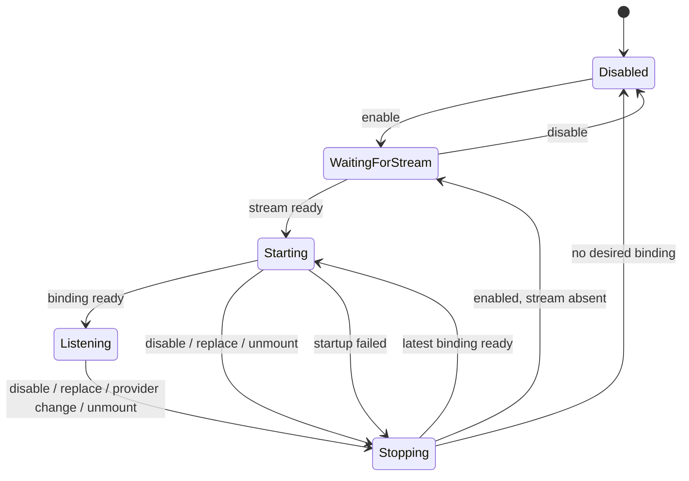
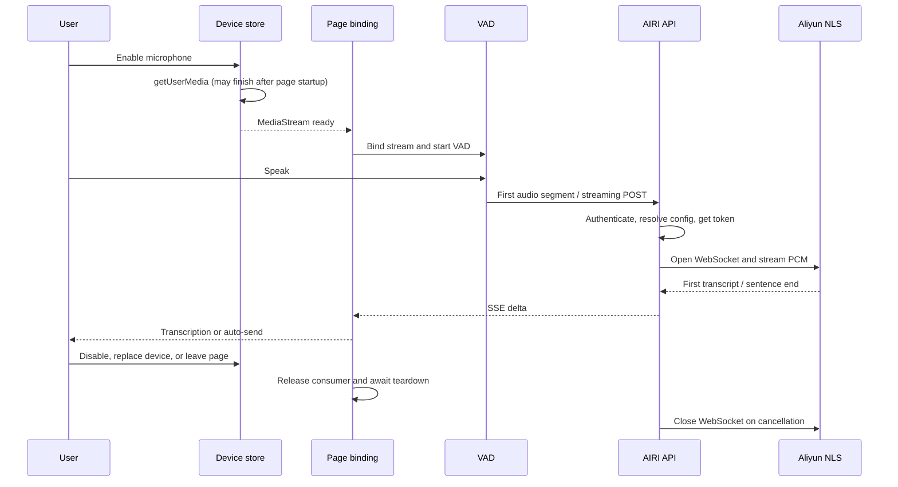

# Liên kết đầu vào bằng giọng nói theo luồng micrô

Trạng thái: Đề xuất

## Bối cảnh

Trang chủ Web và Pocket được sử dụng để bắt đầu nhập bằng giọng nói khi cài đặt `enabled` đã lưu thay đổi. Việc khám phá thiết bị và `getUserMedia` có thể hoàn tất sau. Sau đó, các trang bắt đầu VAD của riêng chúng trên luồng muộn nhưng không liên kết với đường dẫn truyền dữ liệu liên tục ASR. Việc chuyển đổi, thay đổi hoặc ngắt kết nối thiết bị sau này cũng có thể trùng lặp với lần khởi động hoặc dừng không đồng bộ trước đó.

Trong bản sao Edge vào ngày 23 tháng 9 năm 2026, điều khiển micrô vẫn được bật sau hai cụm từ được nói, nhưng bảng Mạng không hiển thị yêu cầu phiên âm và Bảng điều khiển không hiển thị thông báo khởi động Đường ống Thính giác. Sự vắng mặt tương tự vẫn tồn tại sau khi chuyển đổi off/on. Việc làm mới đã khôi phục điều khiển đã bật mà không có thông báo khởi động. Đây là lỗi khởi động phía máy khách, không phải là phép đo độ trễ upstream.

## Phán quyết

- Một trang chỉ liên kết đầu vào bằng giọng nói khi nó có cả `enabled` và `MediaStream`.
- Một ràng buộc xác định đối tượng luồng và chế độ nhà cung cấp. Các thay đổi được tuần tự hóa: giải phóng liên kết cũ, sau đó bắt đầu liên kết được yêu cầu mới nhất.
- truyền dữ liệu liên tục nhà cung cấp sử dụng VAD của đường dẫn Thính giác. nhà cung cấp được ghi hỗ trợ sử dụng trang VAD. Không chạy cả hai máy dò cho cùng một luồng.
- Mỗi truyền dữ liệu liên tục bên sử dụng chỉ phát hành các lệnh gọi lại của riêng nó. Phiên nhà cung cấp được chia sẻ sẽ dừng khi bên sử dụng cuối cùng rời đi.
- Đường ống tuần tự hóa liên kết và phân tách nhà cung cấp. Luồng thay thế sẽ tạo phiên VAD mới, ngay cả khi nhà cung cấp ID không thay đổi.
- Phiên bị hủy không thể gửi lệnh gọi lại bản ghi muộn tới liên kết mới.
- Việc hủy phản hồi ASR sẽ đóng upstream WebSocket của máy chủ và dừng đọc âm thanh yêu cầu.

## Trạng thái mô hình

`Starting → Stopping` chờ khởi động trong chuyến bay trước khi giải phóng một phần tài nguyên của nó. Một khởi đầu cũ hơn trong hàng đợi sẽ bị bỏ qua khi một yêu cầu mới hơn thay thế nó.

## Cấu trúc liên kết truyền dữ liệu liên tục ASR

```mermaid
flowchart LR
  Mic[Browser microphone] --> Device[Audio device store]
  Device --> Page[Web or Pocket binding]
  Page --> VAD[Hearing VAD and segment queue]
  VAD --> HTTP[Streaming HTTP request]
  HTTP --> API[AIRI API: auth and provider config]
  API --> Token[Aliyun token]
  Token --> WS[Aliyun NLS WebSocket]
  WS --> SSE[SSE transcript]
  SSE --> Consumers[Page and chat input consumers]
```

Nhánh từ trình duyệt tới AIRI đã tải âm thanh lên dần dần và nhận SSE. Chỉ thay đổi chặng đó thành WebSocket không loại bỏ bước nhảy AIRI-to-Aliyun. ASR route hiện tại không ghi sổ cái sử dụng của mỗi người dùng; TTS WebSocket route riêng biệt thực hiện cân bằng trước và lập hóa đơn cho phiên của nó khi hoàn thành.

## Trình tự và điểm thời gian

Đo lường micrô sẵn sàng, bắt đầu giọng nói VAD, bắt đầu yêu cầu, hoàn thành token, upstream WebSocket mở, bản ghi đầu tiên và phân phối UI riêng biệt. Yêu cầu bị thiếu phải được báo cáo là lỗi khởi động thay vì được chỉ định độ trễ upstream. Không thể suy ra thời gian upstream từ quá trình tái tạo Edge ở trên.

## Hậu quả

Trang không còn khởi động VAD dự phòng cho truyền dữ liệu liên tục nhà cung cấp nữa. Việc chuyển đổi nhanh và thay thế luồng có thể đợi liên kết trước đó dừng lại, nhưng không thể sử dụng lại luồng cũ hoặc để việc phân tách của nó đóng liên kết mới. Âm thanh trực tiếp tới nhà cung cấp transport và giao thức thanh toán của nó vẫn có các quyết định riêng biệt.
