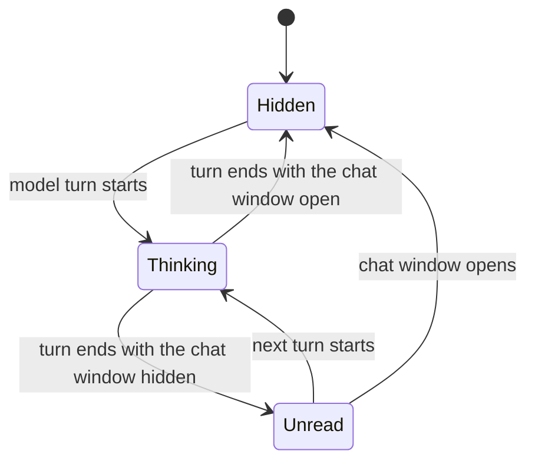

# Bong bóng hiện diện được vẽ bên trong khung vẽ mô hình

Trạng thái: Đã chấp nhận

## Bối cảnh

Chế độ xem chính của desktop không báo cáo gì về những gì AIRI đang làm. Một lượt mô hình trông giống như một cửa sổ nhàn rỗi và các tin nhắn đến trong khi cửa sổ trò chuyện bị ẩn sẽ không để lại dấu vết trên stage. Người dùng bật tính năng chuyển lời nói thành văn bản có thể sử dụng hạn ngạch nhà cung cấp trong một thời gian dài trước khi bất kỳ nội dung nào trên màn hình đề xuất điều đó.

Lần vượt qua đầu tiên đã vẽ bong bóng dưới dạng lớp phủ DOM phía trên khung vẽ stage. Nó đọc chính xác trong khi stage chạy không được khai thác và nó sẽ không đồng bộ hóa ngay khi không hoạt động. `settings/live2d/max-fps` giới hạn mã đánh dấu Pixi, do đó khung vẽ sẽ sơn lại ở tốc độ giới hạn trong khi lớp phủ DOM tuân theo `requestAnimationFrame`. Sau đó, đầu và bong bóng di chuyển theo các đồng hồ khác nhau và bong bóng trượt khỏi đầu trong quá trình chuyển động và kéo cửa sổ.

stage có ba các renderer, được `stageModelRenderer` chọn: `live2d` trên Pixi, `vrm` trên Three và `tachie` trên ảnh tĩnh. Không có biểu đồ cảnh được chia sẻ giữa chúng.

## Phán quyết

- Bong bóng là con của cảnh riêng của mô hình, không phải là lớp DOM phía trên nó. Điểm neo đầu và bong bóng được đọc và ghi bên trong cùng một khung, do đó, nắp khung sẽ di chuyển cả hai hoặc không di chuyển.
- Mỗi `live2d` và `vrm` đều có bộ chuyển đổi riêng. `tachie` không có đầu để theo dõi và không có bong bóng; nó không phải là đường dẫn phương án dự phòng và không báo cáo lỗi.
- Một họa sĩ vẽ bong bóng thành khung vẽ 2D và mỗi bộ chuyển đổi sẽ tải khung vẽ đó lên dưới dạng họa tiết. Giao diện, bố cục và định hình văn bản trực tiếp ở một nơi và ngăn xếp phông chữ hệ thống giữ cho các chữ số CJK và văn bản CJK trong tương lai hoạt động mà không cần phông chữ đi kèm.
- Bong bóng mờ đục và không được khắc ra khỏi bài kiểm tra lần truy cập alpha. Các pixel mà nó vẽ sẽ ngăn cửa sổ di chuyển chuột qua, giống như ký tự.
- Bong bóng hiển thị một điều tại một thời điểm, theo thứ tự ưu tiên: đang suy nghĩ, sau đó chưa đọc. Một dòng nói sẽ được ưu tiên hơn cả khi nó hạ cánh.
- Chưa đọc là một dấu và một số đếm, được vẽ trong cùng một bảng mà các dấu chấm sử dụng, có màu nhấn. Một hình dạng cho cả hai trạng thái được coi là bong bóng của chính nhân vật chứ không phải là huy hiệu dán trên đầu nhân vật. Đó không phải là một câu văn và nhân vật cũng không kể lại câu chuyện đó.

## Độ phân giải neo

VRM cho biết đầu ở đâu: `humanoid.getNormalizedBoneNode('head')` quay lại và gật đầu với nó. Không có gì cho biết nó lớn đến mức nào, vì vậy phạm vi tiếp cận là một phần chiều cao của mô hình, định dạng hình người là điều an toàn để giả định. Khoảng lệch từ xương đến đầu được vẽ theo trục hướng lên của xương, do đó đầu nghiêng vẫn ở bên phải.

Live2D không có xương như vậy. Khu vực truy cập `Head` hoặc `Face` đặt tên cho nó khi tác giả tuyên bố một khu vực, điều mà ba trong số bảy mô hình được vận chuyển cùng với Chủ nghĩa lập thể SDK làm được. Mặt khác, giàn khoan sẽ trả lời: các tham số góc đầu tiêu chuẩn được chuyển về cuối phạm vi xa nhất so với phần còn lại của chúng, vật lý được chạy và các đối tượng có thể vẽ được di chuyển là phần đầu. Cơ thể không được quay như một vật kiểm soát: một cơ thể mang theo đầu, do đó, một cái đầu có thể kéo được sẽ trả lời cho cả hai và việc so sánh cả hai sẽ loại bỏ chính cái đầu đó. Một vật có thể vẽ được chỉ đi theo phần đầu hầu như không di chuyển và một phần chuyển động lớn nhất sẽ làm rơi nó. Sáu trong số bảy tham số xác định ít nhất một tham số góc đầu; thứ bảy là con chó, đầu nó không tự quay được.

mô hình có trạng thái không hiển thị bong bóng. Đặt nó từ vị trí có thể kéo được giả định rằng mô hình được vẽ thẳng đứng mà không có gì phía trên đầu và một chiếc mũ, mái tóc cao hoặc một cánh tay giơ lên ​​sẽ phá vỡ điều đó.

## Trạng thái mô hình

## Hậu quả

- Bảng điều khiển và phần đuôi của nó là một đường viền, được vẽ trong một lần đi bộ. Vẽ chúng thành hai hình dạng và dựa vào phần tô để nối chúng sẽ để lại một đường nối mở lại ở một số góc bất kể phần chồng lên nhau.
- Không có phương pháp điều trị mờ, mờ. `backdrop-filter` làm mờ những gì DOM tổng hợp đằng sau một phần tử và khung vẽ không có gì đằng sau nó: cửa sổ trong suốt và desktop không có trong cảnh. Tỳ Hưu và Ba chỉ có thể làm mờ những gì cảnh đã có. Do đó, bong bóng được vẽ dưới dạng một bảng mờ đục.
- Bong bóng được bao phủ bởi bản sửa đổi kích thước trong `Live2DCanvas`, vì nó được vẽ trong cùng khung với mô hình.
- Bong bóng không cần điểm đánh dấu `data-ambient-light-opaque`. Điểm đánh dấu đó tồn tại cho các lớp phủ bên ngoài khung vẽ; mặt nạ ánh sáng xung quanh đọc canvas alpha và đã tính bất kỳ thứ gì được vẽ trong cảnh là pixel của chính AIRI.
- Chưa đọc yêu cầu một con trỏ đọc, kho lưu trữ này không có. Cửa sổ trò chuyện là một cửa sổ Electron riêng biệt và `electronOpenChat` chuyển đổi nó mà không báo cáo kết quả, vì vậy cửa sổ chính hiện không thể biết liệu cuộc trò chuyện có hiển thị hay không. Tín hiệu đó phải được thêm vào trước khi dữ liệu chưa đọc có thể chính xác.
