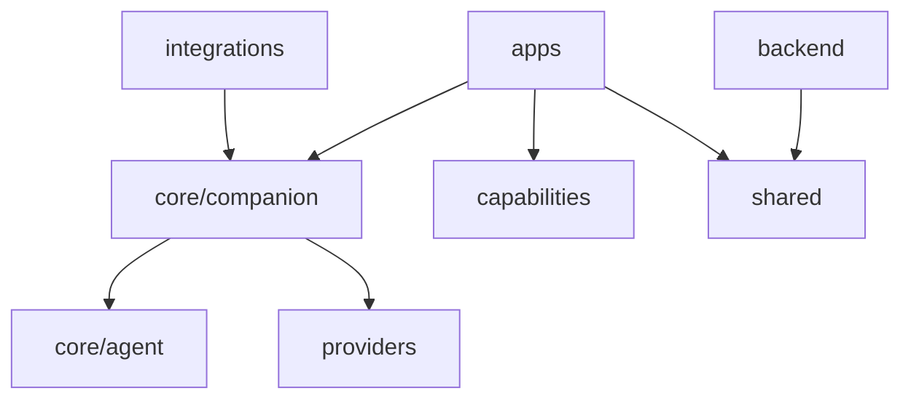

# Domain workspace layout

## Status

Accepted by the project owner on 2026-10-23.

## Decision

Keep one pnpm monorepo. Organize source packages by their functional owner.
Retain existing package names and application behavior during directory moves.

| Directory | Owner |
| --- | --- |
| `apps/` | Desktop, Kirie, web, and terminal entry points |
| `core/` | Agent, character, and shared companion orchestration |
| `providers/` | Inference providers and gateway packaging |
| `capabilities/` | Audio, voice, vision, avatars, input, and computer use |
| `integrations/` | Messaging channels, editor adapters, and plugins |
| `backend/` | Hosted API, channel runtime, contracts, and storage adapters |
| `shared/` | UI, localization, local configuration, SDKs, and development tools |

Imported source stays under its functional owner's `vendor/` directory.
Vendor dependency installation and lint rules remain isolated from the main workspace.
`docs/`, `evals/`, `scripts/`, `deploy/`, and `patches/` remain shared support directories.
The root `.gitignore` owns all ignore rules.
Deferred modules outside this repository remain deferred.

## Runtime ownership

Move companion orchestration and its durable records out of the CLI package.
Desktop and channel adapters consume the companion package directly.
Terminal input, terminal output, argument parsing, and executable lifecycle remain application concerns.
Existing configuration, memory directories, credentials, and session formats remain unchanged.

## Migration

1. Move existing package roots and update workspace, import, asset, packaging, and CI paths.
2. Extract companion orchestration and connect existing hosts to its package exports.
3. Move channel and device adapters to their owning functional groups.
   Telegram, Zalo, and Discord companion adapters now have independent package manifests.
   Voice and camera clients own their resources and build exports.
4. Update contributor instructions in a separate configuration commit.

## Dependency direction

## Validation

Check workspace discovery and local dependency links after relocation.
Run package typechecks, existing runtime and adapter tests, and application builds.
Run the repository typecheck and lint before completion.
Compare third-party dependency versions with the previous lockfile.
Check that source paths and portable resource paths agree.
