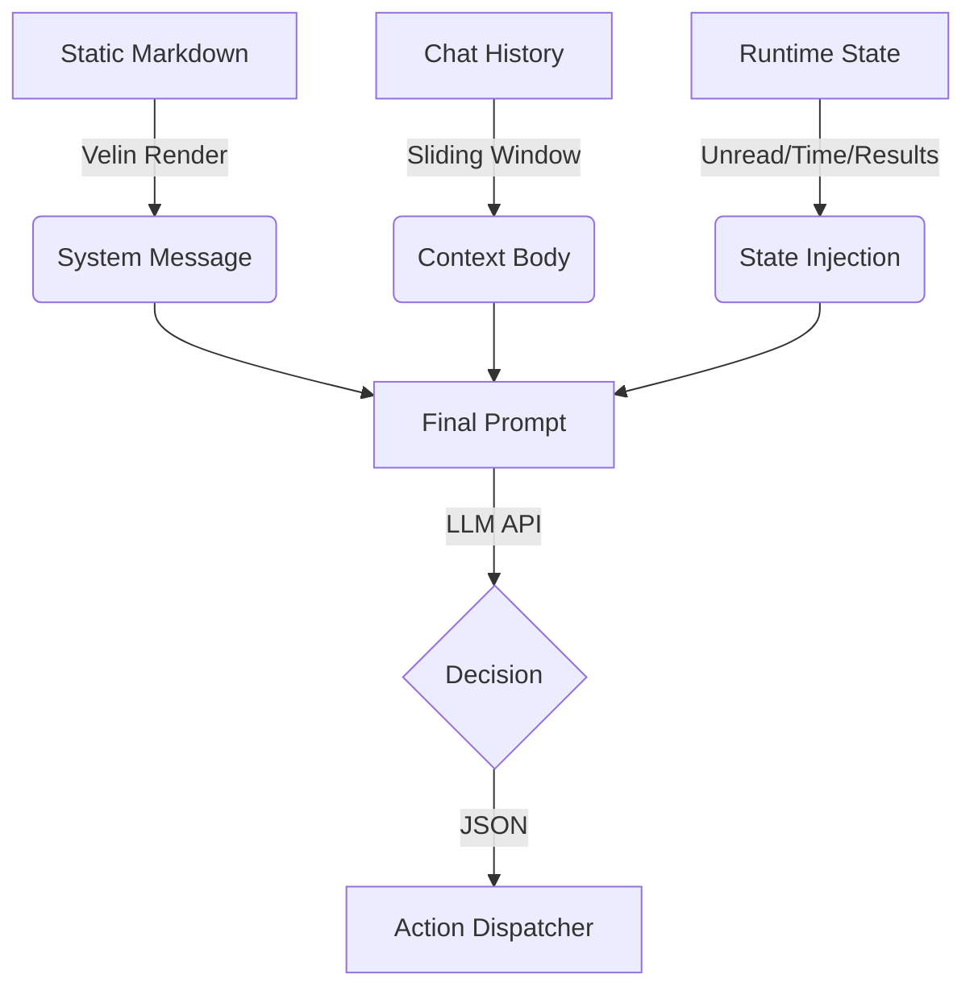

### **Kiến trúc prompt: Vòng lặp hành động được đưa vào ngữ cảnh**

Bot triển khai **"Vòng lặp tác nhân nhận biết trạng thái"** thay vì cấu trúc Chat-QA đơn giản. prompt được xây dựng linh hoạt ở mỗi tích tắc của vòng lặp.

#### **1. Lớp tĩnh (Định nghĩa hệ thống)**

* **Nguồn:** `src/core/planner/prompts/*.velin.md`
* **Trình tải:** `src/core/planner/prompts/index.ts`
* **Vai trò:** Xác định "Linh hồn" và "Quy tắc".
* **Thành phần:**
    * **Định nghĩa giao thức (`system-action-gen-v1`):** Mã hóa cứng lược đồ JSON cho các công cụ có sẵn (`send_message`, `read_unread_messages`, `sleep`) và luồng logic (ví dụ: "Phải kiểm tra tin nhắn chưa đọc sau khi gửi").
    * **Persona (`personality-v1`):** Xác định nhân vật "Angela" (giọng điệu, ngắn gọn, tự nhiên).

#### **2. Lớp lịch sử (Bộ nhớ ngắn hạn)**

* **Nguồn:** Mảng `messages` trong bộ nhớ (`ChatContext`).
* **Vai trò:** Cung cấp tính liên tục trong cuộc trò chuyện.
* **Cơ chế:** Một cửa sổ trượt gồm ~20 tin nhắn cuối cùng (lần quay User/Assistant) được đưa trực tiếp vào sau hệ thống prompt.

#### **3. Lớp trạng thái động (Tiêm cảm giác)**

* **Nguồn:** `src/core/planner/llm-client.ts` (được tạo bởi runtime)
* **Vai trò:** Cung cấp "Nhận thức tình huống" và "đối chiếu ngữ cảnh".
* **Cơ chế:** **Thông báo người dùng** tổng hợp được thêm vào cuối cửa sổ ngữ cảnh, buộc LLM phải tập trung vào thực tế trước mắt. Nó chứa:
    * **Luồng đến**: Nội dung thô của tin nhắn mới đến *bây giờ* (được truyền từ `scheduler`).
    * **Lịch sử hành động**: Kết quả của việc thực thi công cụ *ngay trước đó* (ví dụ: "Hành động: send_message, Kết quả: Thành công").
    * **Môi trường**: Giờ máy chủ hiện tại.
    * **Trạng thái chung**: Bản tóm tắt số lượng tin nhắn chưa đọc trên tất cả các kênh (`unreadEvents`).
    * **Kích hoạt**: Hướng dẫn cuối cùng: *"Dựa trên ngữ cảnh... Phản hồi bằng hành động... chỉ trong JSON."*

---

### **Tóm tắt luồng dữ liệu**

### **Đặc điểm chính**

1. **Thực thi JSON**: Bot không sử dụng API "Gọi hàm" native (như Công cụ OpenAI). Nó dựa vào **prompt Engineering** để buộc mô hình xuất ra JSON thô, sau đó được `best-effort-json-parser` phân tích cú pháp.
2. **Logic không trạng thái**: prompt thông báo rõ ràng cho LLM "Bạn có X tin nhắn chưa đọc" trong mỗi lượt, khiến LLM trở thành người đưa ra quyết định duy nhất về kiểm soát luồng (Đọc, Trả lời và Ngủ).
3. **Quan sát-Phản ánh**: prompt bao gồm `History actions`, cho phép LLM "nhìn thấy" kết quả của lần thử trước đó (ví dụ: nếu một hành động đọc trả về trống, nó sẽ biết dừng lại).
