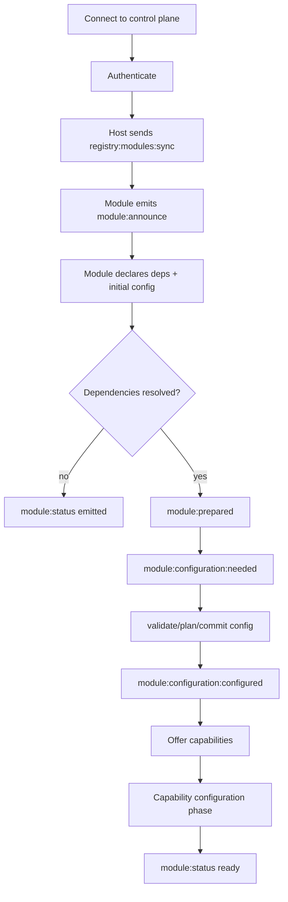

<a id="angela-plugin-platform"></a>

# Nền tảng plugin Angela

- [Tóm tắt](#summary)
- [Nền](#background)
- [Mục tiêu](#goals)
- [Không có mục tiêu](#non-goals)
- [Đề xuất](#proposal)
- [Chi tiết thiết kế](#design-Details)
- [Mặt phẳng điều khiển và dữ liệu](#control-and-data-planes)
- [Plugin host và Trình xem](#plugin-host-and-viewers)
- [Tổng quan về vòng đời plugin](#plugin-lifecycle-overview)
- [Cầu nối và plugin từ xa](#bridges-and-remote-plugins)
- [Trừu tượng hóa giao thông](#transport-abstraction)
- [Mô hình khả năng](#capability-model)
- [Chế độ triển khai](#deployment-modes)
- [Bản kê khai và điểm vào](#manifest-and-entrypoints)
- [Xác minh và kiểm tra](#verify--test)
- [Tiêu chí](#criteria)
- [Test & QA](#test--qa)
- [Tiến trình](#progress)
- [Trạng thái](#status)
- [Các bước tiếp theo](#next-steps)
- [Đánh giá](#reviews)
- [Q&A](#qa)
- [Tài liệu liên quan](#related-documentations)

<a id="summary"></a>

## Bản tóm tắt

Angela là một hệ thống đa Node, nơi các plugin, cầu nối và trình xem giao tiếp qua các phương tiện truyền tải Eventa. Plugin host tải plugin, cung cấp một bề mặt API duy nhất cũng như điều khiển và dữ liệu route trên các thiết bị. Nền tảng này tách mặt phẳng điều khiển khỏi mặt phẳng dữ liệu, hỗ trợ các plugin cục bộ và từ xa, đồng thời cho phép phối hợp nhiều thiết bị mà không cần thay đổi API plugin.

<a id="background"></a>

## Lý lịch

Angela cần chạy trên desktop, web và thiết bị di động trong khi vẫn giữ một bề mặt API sạch sẽ. Các plugin phải có khả năng đăng ký UI, khai báo các khả năng và trao đổi dữ liệu với các cầu nối dành riêng cho thiết bị. Để duy trì khả năng mở rộng của hệ thống, các luồng tốc độ cao phải được tách biệt khỏi lưu lượng truy cập cấu hình và vòng đời.

Việc phối hợp phụ thuộc runtime được cố tình chia thành một tài liệu thiết kế chuyên dụng để giữ cho tài liệu kiến ​​trúc này tập trung vào hình dạng và mặt phẳng nền tảng.

<a id="goals"></a>

## Bàn thắng

- Cung cấp một bề mặt API plugin duy nhất trên runtime.
- Tách biệt vòng đời và lưu lượng cấu hình khỏi các luồng tốc độ cao.
- Hỗ trợ các plugin cục bộ và các plugin từ xa có cùng giao thức.
- Cho phép nhiều người xem và cầu nối phối hợp thông qua mặt phẳng điều khiển chung.
- Duy trì việc triển khai linh hoạt: Plugin host được nhúng, bên ngoài hoặc từ xa.

<a id="non-goals"></a>

## Ngoài phạm vi

- Xác định máy trạng thái vòng đời plugin đầy đủ trong tài liệu này.
- Chỉ định bố cục UI chi tiết hoặc triển khai trình xem.
- Triển khai transport mới ngoài bộ điều hợp Eventa.

<a id="proposal"></a>

## Đề xuất

- Sử dụng Eventa cho tất cả lưu lượng dữ liệu và điều khiển.
- Sử dụng mặt phẳng điều khiển chuyên dụng cho cấu hình, quyền, UI và định tuyến.
- Sử dụng mặt phẳng dữ liệu cho các luồng có dung lượng lớn như âm thanh, hình ảnh và đo từ xa.
- Chạy các plugin bên trong Plugin host để tải các điểm vào của plugin và hiển thị SDK.
- Hãy coi các cầu nối là sự tích hợp dành riêng cho thiết bị chỉ cung cấp dữ liệu và hành động.

<a id="design-details"></a>

## Chi tiết thiết kế

Thiết kế nền tảng tập trung vào các API nhất quán, tích hợp bất khả tri transport và điều phối đa thiết bị.

<a id="control-and-data-planes"></a>

### Mặt phẳng điều khiển và dữ liệu

Mục đích của mặt phẳng điều khiển: vòng đời, cấu hình, chính sách định tuyến, quyền và đóng góp của UI.

Thông báo điều khiển điển hình:

- điều khiển: xin chào
- kiểm soát:thông báo
- điều khiển:plugin:đăng ký
- điều khiển:plugin:config:get
- điều khiển:plugin:config:set
- kiểm soát:khả năng:cấp
- kiểm soát:khả năng:thu hồi
- điều khiển:ui:đăng ký

Mục đích của mặt phẳng dữ liệu: luồng thời gian thực và thông lượng cao.

Thông điệp dữ liệu điển hình:

- dữ liệu:bối cảnh:cập nhật
- dữ liệu:tầm nhìn:khung
- dữ liệu: âm thanh: luồng
- dữ liệu:bảng điểm
- dữ liệu: ký tự: đầu ra

Cả hai máy bay đều sử dụng tin nhắn Eventa. Tùy chọn transport:

- Hai điểm cuối WebSocket
- Một kết nối đa kênh với không gian tên

<a id="plugin-host-and-viewers"></a>

### Plugin host và người xem

Plugin host là một quy trình Node:

- Tải các điểm vào plugin.
- Lộ diện Angela SDK.
- Đăng ký đóng góp UI.
- Đàm phán về khả năng.
- Kết nối với mặt phẳng điều khiển và dữ liệu.

Người xem hiển thị UI và đầu ra ký tự. Ví dụ:

- Electron stage với các tính năng của Bộ cấu hình.
- Máy khách cấu hình web.
- Máy khách stage bỏ túi.

<a id="plugin-lifecycle-overview"></a>

### Tổng quan về vòng đời của plugin

Vòng đời bên dưới phản ánh nhận xét chi tiết về vòng đời của `packages/plugin-sdk/src/plugin-host/core.ts` và tập trung vào các giai đoạn công bố mô-đun, cấu hình và khả năng.



Điều phối phụ thuộc khả năng chi tiết, các giai đoạn chờ và tính sẵn sàng cổng kiểm tra được xác định trong `capability-orchestration.md`.

<a id="bridges-and-remote-plugins"></a>

### Cầu nối và plugin từ xa

Cầu nối các thiết bị và dịch vụ bên ngoài với Angela. Họ không sở hữu UI; họ chỉ cung cấp dữ liệu và hành động. Ví dụ:

- Phần mở rộng mã VS cho ngữ cảnh và lệnh của trình soạn thảo.
- Tiện ích mở rộng trình duyệt cho ngữ cảnh trang.
- Dịch vụ Minecraft cho các sự kiện và lệnh trong trò chơi.

Plugin từ xa là các dịch vụ bằng bất kỳ ngôn ngữ nào kết nối qua Eventa và khả năng đăng ký. Chúng được ưu tiên để tích hợp máy chủ và ngăn xếp non-JS/TS.

<a id="transport-abstraction"></a>

### Trừu tượng transport

Tất cả các lệnh gọi SDK đều không theo thuyết bất khả tri transport. host kiểm soát xem giao tiếp là IPC cục bộ hay RPC từ xa mà không thay đổi API plugin.

<a id="capability-model"></a>

### Khả năng mô hình

Mỗi Node thông báo khả năng đăng ký. Mặt phẳng điều khiển cấp hoặc từ chối các quyền và yêu cầu route dựa trên chính sách.

Khả năng ví dụ:

- bối cảnh.read
- bối cảnh.write
- ui.panel
- ui.widget
- tầm nhìn.thu nhận dữ liệu
- tầm nhìn.stream
- thiết bị.mobile.sensors

<a id="deployment-modes"></a>

### Chế độ triển khai

Plugin host có thể chạy ở ba chế độ:

1. Được nhúng trong Electron main để cài đặt và sử dụng.
2. Quá trình Node bên ngoài để tải lại và cách ly nóng.
3. Máy chủ từ xa đảm bảo tính liên tục trên nhiều thiết bị.

<a id="manifest-and-entrypoints"></a>

### Bản kê khai và điểm vào

Các plugin khai báo siêu dữ liệu trong tệp kê khai và cung cấp các điểm nhập runtime.

Ví dụ:

```json
{
  "id": "airi.vscode",
  "name": "Angela VS Code",
  "version": "1.0.0",
  "capabilities": ["context.read", "ui.panel", "commands"],
  "entrypoints": {
    "node": "./dist/node/index.js"
  }
}
```

<a id="verify--test"></a>

## Xác minh & Kiểm tra

<a id="criteria"></a>

### Tiêu chuẩn

- host có thể tải các plugin và đăng ký UI cũng như các khả năng.
- Cầu có thể kết nối và được phát hiện bởi mặt phẳng điều khiển.
- Các luồng mặt phẳng dữ liệu luôn tách biệt với lưu lượng mặt phẳng điều khiển.
- Bề mặt API của plugin tương tự hoạt động trên desktop, web và thiết bị di động.

<a id="test--qa"></a>

### Kiểm tra & QA

- Kiểm tra tích hợp: host + trình xem + cầu nối với định tuyến mặt phẳng điều khiển.
- Kiểm tra tích hợp: mặt phẳng dữ liệu truyền dữ liệu liên tục với nguồn tốc độ cao.
- Kiểm tra khả năng tương thích: các điểm vào plugin giống nhau trên nhiều runtime.

<a id="progress"></a>

## Tiến triển

<a id="status"></a>

### Trạng thái

Thiết kế năng động.

<a id="next-steps"></a>

### Các bước tiếp theo

- Căn chỉnh tài liệu runtime với bối cảnh plugin được cập nhật và chiến lược transport.
- Tích hợp đăng ký khả năng và chuyển tiếp vòng đời cổng kiểm tra sẵn sàng từ `capability-orchestration.md`.
- Mở rộng các ví dụ về plugin từ xa theo ngôn ngữ.

<a id="reviews"></a>

## Đánh giá

<a id="qa"></a>

### Hỏi đáp

- Câu hỏi: Tại sao phải phân chia mặt phẳng điều khiển và mặt phẳng dữ liệu? Đáp: Lưu lượng truy cập trong vòng đời và các luồng tốc độ cao có độ tin cậy và nhu cầu QoS khác nhau.

- Câu hỏi: Cầu nối có hiển thị UI không? Đáp: Không. UI được đóng góp cho người xem thông qua mặt phẳng điều khiển.

- Câu hỏi: Có thể viết các plugin từ xa mà không cần JS hoặc npm không? Đ: Vâng. Họ chỉ cần nói giao thức Eventa qua WebSocket.

<a id="related-documentations"></a>

### Tài liệu liên quan

- Bối cảnh plugin [Multi-transport](./multi-transport.md)
- [Dàn nhạc mô-đun định hướng khả năng](./capability-orchestration.md)
