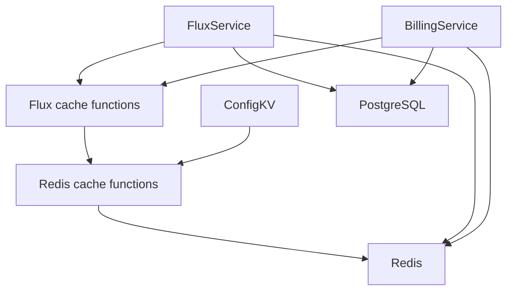
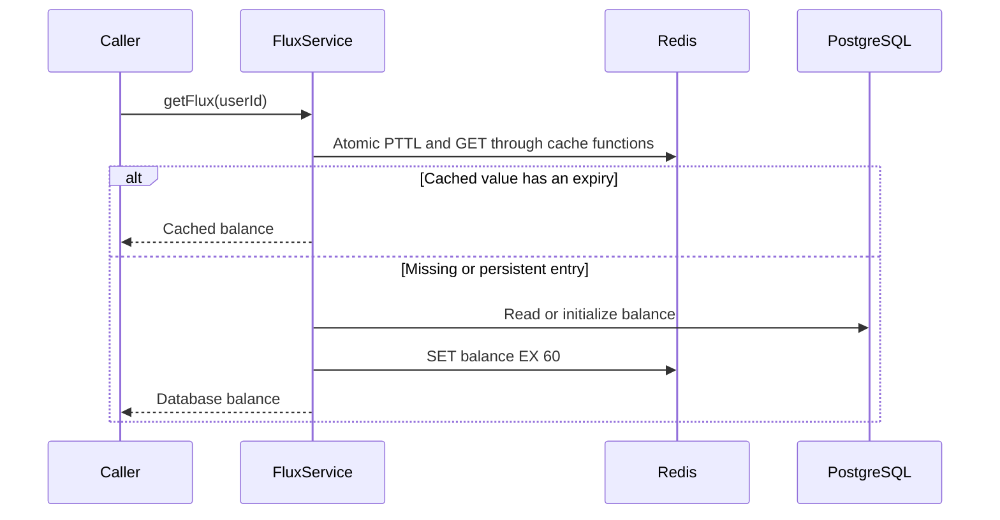

<a id="redis-cache-functions-and-flux-balance-expiry"></a>

# Chức năng bộ đệm Redis và hết hạn số dư Flux

Trạng thái: đã chấp nhận

<a id="decision"></a>

## Phán quyết

Mọi ghi vào `user:{userId}:flux` đều sử dụng `SET EX 60`. Giá trị và thời hạn sử dụng thay đổi nguyên tử. Lượt truy cập bộ đệm không gia hạn thời hạn sử dụng. bên đọc chỉ chấp nhận các mục đã hết hạn. Các mục liên tục tải lại từ PostgreSQL và nhận cùng một TTL. PostgreSQL vẫn là cơ quan quản lý số dư và sổ cái.

Sáu mươi giây giới hạn khả năng hiển thị số dư cũ sau khi vô hiệu hóa không thành công hoặc sắp xếp lại việc ghi bộ nhớ đệm trong khi vẫn giữ lại bộ nhớ đệm đọc ngắn. Mỗi lần đọc Flux sử dụng một lệnh gọi Lua để kiểm tra giá trị và thời hạn sử dụng một cách nguyên tử. Tải lại ảnh chụp nhanh số dư không đúng định dạng từ PostgreSQL. Việc ghi đồng thời vẫn có thể thay thế số dư mới hơn. Giới hạn hết hạn giới hạn thời gian tồn tại của mỗi ảnh chụp nhanh được lưu trong bộ nhớ đệm nhưng không tuần tự hóa cơ sở dữ liệu và ghi vào bộ đệm.

<a id="ownership"></a>

## quyền sở hữu

Các hàm không trạng thái trong `libs/redis/cache.ts` sở hữu các lần đọc Redis sắp hết hạn và ghi nguyên tử với TTL dương bắt buộc. Họ truyền bá lỗi và không sở hữu các kết nối, thử lại, đọc cơ sở dữ liệu hoặc quy tắc thanh toán. Các hàm miền trong `services/domain/flux-cache.ts` sở hữu định dạng cân bằng và TTL 60 giây. Các dịch vụ hiện tại giữ nguyên ranh giới xử lý lỗi và giao dịch của chúng. Không cần đăng ký dịch vụ mới hoặc tiêm phụ thuộc. ConfigKV chia sẻ chức năng ghi và giữ lại hành vi đọc và lỗi hiện có.

<a id="scope"></a>

## Phạm vi

Khởi tạo số dư, điền vào bộ đệm cơ sở dữ liệu, ghi nợ, credit và đồng bộ hóa bộ đệm thanh toán chia sẻ TTL. Việc ghi đè của quản trị viên và việc xóa tài khoản sẽ giữ lại tình trạng vô hiệu hóa bộ đệm hiện có của họ. Các phím liên tục chưa được chạm tới vẫn còn cho đến khi đọc số dư hoặc thay đổi trạng thái thay thế chúng. Không có quá trình quét khóa sản xuất nào được thực hiện trong thay đổi này.

<a id="non-goals"></a>

## Ngoài phạm vi

Không có thay đổi sổ cái, thay đổi thời hạn sử dụng đồng hồ nợ, khóa phân phối hoặc hoạt động dữ liệu sản xuất.

<a id="module-dependencies"></a>

## Phần phụ thuộc của mô-đun



<a id="affected-files"></a>

## Các tập tin bị ảnh hưởng

```text
server/apps/api/src/
  libs/redis/cache.ts
  libs/redis/cache.test.ts
  services/adapters/config-kv/store.ts
  services/domain/
    flux-cache.ts
    flux.ts
    flux.test.ts
    billing/
      billing-service.ts
      tests/billing-service.test.ts
```

<a id="read-sequence"></a>

## Đọc trình tự



<a id="verification"></a>

## Xác minh

Sử dụng ranh giới thử nghiệm PGlite và Redis hiện có. Xác minh quá trình khởi tạo hết hạn, tải lại cơ sở dữ liệu, ghi nợ, credit và đồng bộ hóa thanh toán. Nâng cao đồng hồ kiểm tra để xác minh rằng các lần truy cập bộ đệm không gia hạn khi hết hạn và tải lại số dư đã hết hạn mà không có khoản trợ cấp ban đầu khác. Xác minh rằng số dư được lưu trong bộ nhớ đệm liên tục được tải lại từ PostgreSQL.

<a id="redis-key-names"></a>

## Tên khóa Redis

Khóa xác định miền sở hữu mà không có tiền tố `cache:`. ConfigKV sử dụng `config:{key}`. Giá sọc sử dụng `stripe:prices`. Flux giữ `user:{userId}:flux`. TTL không thay đổi. Các phiên bản mới điền vào các khóa mới theo yêu cầu. Các khóa hết hạn hiện tại sẽ hết hạn một cách tự nhiên. Trong quá trình triển khai luân phiên, các phiên bản cũ và mới sử dụng các khóa ConfigKV và Stripe riêng biệt. Tính vô hiệu chỉ ảnh hưởng đến không gian tên của người gọi, vì vậy không gian tên khác có thể vẫn cũ cho đến khi TTL 300 giây hiện có của nó hết hạn. Không có thao tác quét khóa, xóa hoặc phương án dự phòng nào được thêm vào tên cũ.
