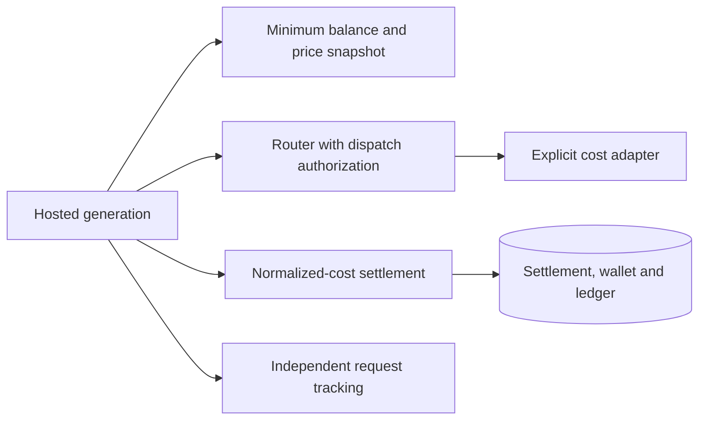
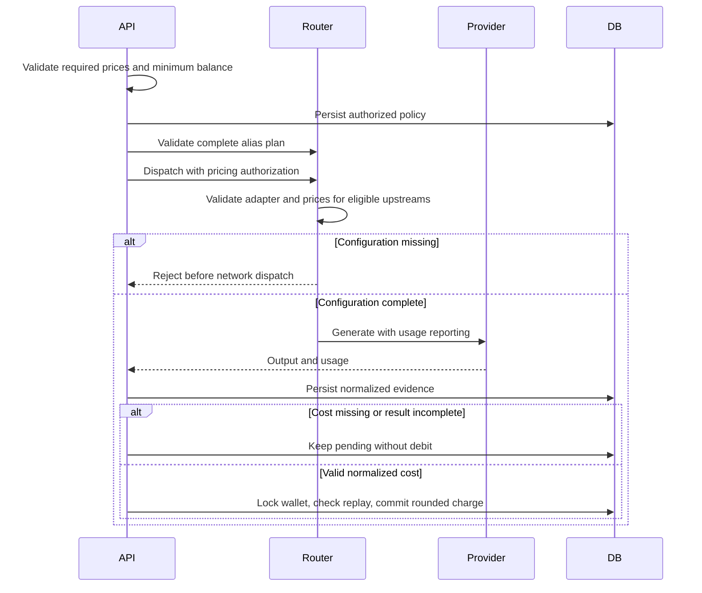

<a id="default-normalized-cost-llm-settlement"></a>

# Thanh toán LLM chi phí chuẩn hóa mặc định

Ngày: 27-09-2026 Trạng thái: đã chấp nhận

<a id="decision-and-scope"></a>

## Quyết định và phạm vi

Theo dõi yêu cầu đã được hợp nhất vào main. PR này chỉ thêm di chuyển thanh toán 0027. Mỗi cuộc gọi hosted Chat Completions và Responses đều sử dụng thanh toán chi phí chuẩn hóa. Không có đường dẫn thanh toán chi phí tùy chọn và không có tỷ lệ LLM token hoặc phương án dự phòng theo yêu cầu.

<a id="requirements"></a>

## Yêu cầu

| Quy tắc | Ranh giới thực hiện |
| --- | --- |
| Quyết toán chi phí mặc định | hosted sinh nội dung route luôn lưu và quyết toán biên lai chi phí |
| Thiếu bộ chuyển đổi hoặc giá | Xác thực chính sách giá đã nắm bắt và mọi upstream đủ điều kiện trước khi gửi đi; từ chối lỗi cấu hình |
| Thiếu chi phí trả lại | Giữ biên nhận đang chờ xử lý; không bao giờ suy ra chi phí từ tỷ lệ Flux token cũ |
| Số dư có thể gọi tối thiểu | LLM_MINIMUM_BALANCE tách biệt với khoản phí thực tế; mặc định năm Flux giữ nguyên ngưỡng nhập học trước đó |
| Bộ chuyển đổi bảng giá rõ ràng | Bộ điều hợp trong tương lai được hỗ trợ có thể tạo ra giá USD bình thường từ bảng giá mô hình đã được phiên bản và mức sử dụng được đo lường |
| Tiếp tục sạc giọng nói | Duy trì tính năng ghi nợ chung và đo lường TTS/ASR; chỉ loại bỏ lựa chọn tỷ lệ cố định LLM |

Không có giá bán mặc định nào được cung cấp. LLM_COST_BILLING hiện là cấu hình giá bắt buộc, không phải là tính năng cổng kiểm tra. Tất cả các phiên bản ngược dòng đủ điều kiện của ứng viên router phải có bộ chuyển đổi và giá được hỗ trợ. Lỗi cấu hình sẽ dừng bí danh phương án dự phòng; nó không được trở thành một công tắc ẩn sang chính sách tính phí khác. Chính sách đã thu thập sẽ được sử dụng lại cho mỗi lần gửi văn bản cục bộ và đối chiếu sau này.

<a id="architecture"></a>

## Ngành kiến ​​​​trúc





Các tập tin bị ảnh hưởng:

```text
server/apps/api/
  src/services/adapters/llm/cost.ts
  src/services/adapters/config-kv/definitions.ts
  src/services/domain/billing/
  src/services/domain/llm-router/{router,types}.ts
  src/routes/openai/v1/{middlewares/billing,model-routing,operations}/
  src/schemas/{llm-request-settlement,flux,flux-transaction}.ts
  drizzle/0027_llm_cost_settlement.sql
```

<a id="cost-adapter-contract"></a>

## Hợp đồng điều chỉnh chi phí

Bộ điều hợp tạo ra chi phí USD, một nguồn chi phí, tương quan sinh nội dung và hỗ trợ việc sử dụng có giới hạn. Bộ điều hợp OpenRouter đã triển khai sử dụng chi phí do nhà cung cấp báo cáo và từ chối tính toán BYOK không được hỗ trợ. Bộ điều hợp bảng giá mô hình trong tương lai là chế độ định giá hạng nhất, không phục hồi từ biên lai nhà cung cấp bị thiếu. Nó phải xác thực mô hình được yêu cầu và hoàn thành các kích thước giá trước khi gửi đi, giữ lại phiên bản bảng giá và tính toán chi phí từ mức sử dụng được đo bằng bộ nhớ đệm rõ ràng và các quy tắc suy luận. Các thứ nguyên bị thiếu vẫn đang chờ xử lý. Thay đổi này không triển khai hoặc điền vào bảng giá mô hình.

<a id="persistence-and-compatibility"></a>

## Tính kiên trì và khả năng tương thích

Di chuyển 0027 tạo các chỉ mục không đồng thời. Việc triển khai sổ cái hiện có cần được đánh giá trong thời gian phát hành. Trả lại chi phí bị thiếu hoặc không hợp lệ sau giao dịch biên nhận lâu dài mà không có khóa ví thứ hai. Biên nhận đã được thanh toán sẽ được trả lại theo khóa ví đầu tiên mà không cần giao dịch hoặc ghi nợ khác. Việc thanh toán thành công sẽ giữ lại ảnh chụp nhanh chi phí đã tính trong cùng một giao dịch với bản cập nhật ví và sổ cái.

Xác thực thanh toán cho mọi upstream đủ điều kiện trong gói bí danh hoàn chỉnh trước khi cử ứng viên đầu tiên. Tiếp tục xác thực thời gian gửi đi để từ chối các thay đổi cấu hình giữa quá trình xác thực gói và lần thử sau. router sở hữu lựa chọn ứng viên và xác thực trước chuyến bay. Hoạt động giao thức cung cấp chính sách thanh toán được ủy quyền.

Kiên trì theo dõi yêu cầu trước khi thanh toán. Nếu định tuyến thoát mà không gửi khóa, hãy đóng phần nhập chưa được giải quyết dưới dạng cancelled/not_dispatched thay vì để lại công việc sai đang chờ xử lý. Cuộc gọi upstream đã thử vẫn đang chờ xử lý khi không xác định được kết quả hoặc chi phí của nó. Không tính phí hoàn tất việc thanh toán mà không có hàng sổ cái ghi nợ. Đếm các khoản thanh toán thiếu vốn một lần sau khi cam kết. Giữ nguyên sinh nội dung ID đầu tiên khi các khung Trò chuyện sau này không đồng ý và giữ biên nhận đó đang chờ xử lý.

Việc thanh toán sử dụng requestFlux và chargeFlux cho số tiền được yêu cầu và số tiền bị tính phí. Số tiền được tính là ảnh chụp nhanh kết quả được cam kết với mục nhập sổ cái của nó, không phải là cơ quan ghi nợ thứ hai. Sổ cái sở hữu những thay đổi về số dư thực tế; quyết toán sở hữu chi phí chuẩn hóa, nguồn chi phí, giá cả và cách sử dụng nhà cung cấp đã được vệ sinh. Không sao chép giá và chi phí nhà cung cấp vào siêu dữ liệu sổ cái hoặc sao chép toàn bộ quan sát chẩn đoán vào quyết toán. Không cần phiên bản lược đồ hàng hoặc phiên bản bằng chứng lồng nhau cho lược đồ dàn xếp một định dạng này. Trường SchemaVersion của nhật ký yêu cầu vẫn không thay đổi. Đó là một hợp đồng chẩn đoán, không phải là cơ quan giải quyết. Việc sử dụng Flux ADR sẽ loại bỏ trường fluxConsumed của nhật ký yêu cầu.

Áp dụng di chuyển theo dõi 0026 trước di chuyển thanh toán 0027. Những di chuyển này thay thế các bản nháp PR chưa được xuất bản, các di chuyển dự thảo chưa được áp dụng. Việc giải quyết sở hữu ảnh chụp nhanh về giá và bằng chứng lâu dài. Nhật ký không truy vấn hoặc cập nhật bộ nhớ thanh toán. Lưu bằng chứng đang chờ xử lý trước khi tính phí. Cam kết ví, sổ cái và trạng thái thanh toán dưới khóa ví. Tính năng phát lại đã giải quyết không thể tính phí hai lần. Giữ nguyên nhà cung cấp, sinh nội dung ID gốc và ảnh chụp nhanh giá. Mỗi yêu cầu tính phí trần(costUsd × fluxPerUsd × hệ số nhân) trong toàn bộ Flux. Làm tròn một lần, sau khi nhân, sử dụng số học thập phân để tránh tính phí quá mức cho ranh giới dấu phẩy động. Chi phí bằng 0 rõ ràng vẫn bằng 0. Chi phí còn thiếu vẫn đang chờ xử lý. Không có số dư phân đoạn giữa các yêu cầu. Loại bỏ các trường còn lại của bản nháp chưa được hợp nhất khỏi quá trình di chuyển 0027; không thêm di chuyển khác. Đo lường giọng nói và hành vi nợ Redis của nó vẫn không thay đổi. Việc triển khai LLM không có bộ điều hợp được hỗ trợ và giá được định cấu hình hiện từ chối các yêu cầu một cách có chủ ý. LLM_MINIMUM_BALANCE là ngưỡng nhập học, không phải là mức đặt trước hoặc phí cố định. Các giá trị FLUX_PER_REQUEST và FLUX_PER_1K_TOKENS cũ không còn ảnh hưởng đến các yêu cầu hosted LLM nữa.

<a id="non-goals-and-verification"></a>

## ngoài phạm vi và xác minh

Không có cấu hình, triển khai, đối chiếu tự động giá sản xuất worker hoặc triển khai bảng giá mô hình. Kiểm tra configuration/adapter bị thiếu trước khi gửi đi, giải quyết chi phí mặc định, chi phí bằng 0 so với không có, tính độc lập của số dư tối thiểu, xác thực gửi phương án dự phòng, luồng bị gián đoạn, phát lại và hồi quy máy đo giọng nói. Xác minh mức trần độc lập theo yêu cầu, ranh giới thập phân chính xác, chi phí dương nhỏ, phát lại đồng thời và khôi phục giao dịch. Áp dụng cả hai lần di chuyển cục bộ. Chạy thử nghiệm tập trung, workspace kiểm tra kiểu dữ liệu và lint.
