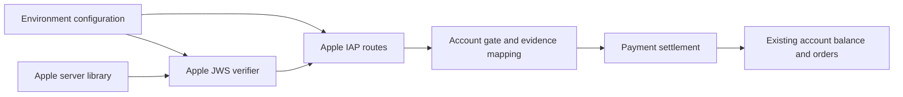
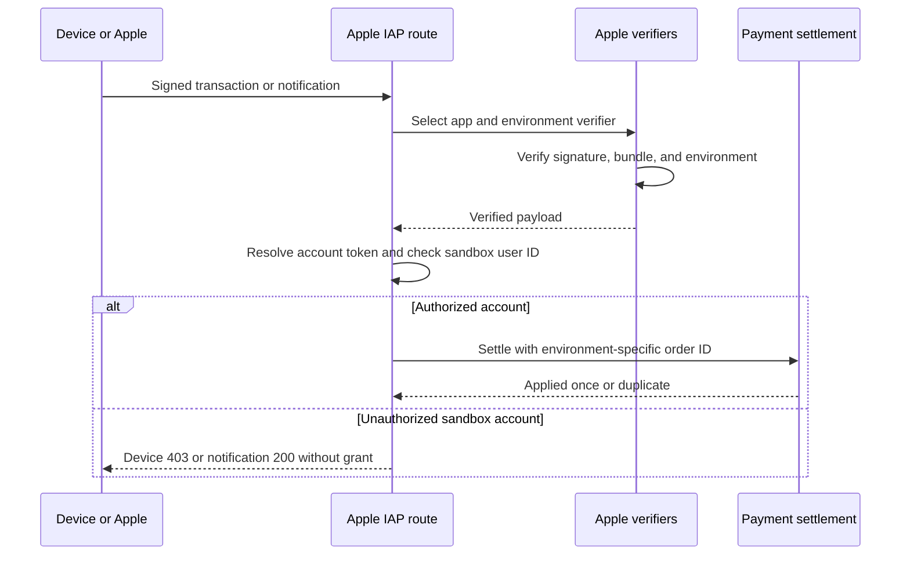

<a id="apple-iap-sandbox-accounts"></a>

# Tài khoản hộp cát Apple IAP

Trạng thái: đã chấp nhận. Người yêu cầu đã xác nhận các tài khoản thử nghiệm chuyên dụng.

<a id="decision"></a>

## Phán quyết

Giữ `APPLE_IAP_ENV=production` trên API được chia sẻ. Thêm danh sách `APPLE_IAP_SANDBOX_USER_IDS` tùy chọn gồm ID người dùng nội bộ chính xác. Danh sách trống sẽ giữ nguyên việc xác minh sản xuất. Danh sách không trống sẽ kích hoạt trình xác minh Apple Sandbox thứ hai. Các yêu cầu về gói và môi trường chưa được xác minh hãy chọn một người xác minh. Mỗi người xác minh sẽ giữ lại chữ ký và kiểm tra gói của Apple. Xác minh Xcode không bao giờ là phương án dự phòng trên API sản xuất.

Sau khi xác minh, cả việc gửi thiết bị và thông báo tính phí đều kiểm tra tài khoản đã giải quyết dựa trên danh sách trước khi giải quyết. Người dùng thiết bị chưa niêm yết nhận được 403 và giữ giao dịch để thử lại sau. Một thông báo không công khai sẽ nhận được 200 mà không cần trợ cấp. Tài khoản token vẫn phải thuộc về người dùng.

Đơn đặt hàng hộp cát sử dụng `sandbox:<bundleId>:<transactionId>` làm đơn đặt hàng bộ xử lý ID. ID sản xuất không thay đổi. Cả hai đường dẫn phân phối đều sử dụng cùng một khóa. Phong bì thông báo và giao dịch bên trong phải có cùng gói và môi trường.

<a id="scope-and-non-goals"></a>

## Phạm vi và ngoài phạm vi

Đây là kiểm soát quyền truy cập cấp tài khoản, không phải ví hoặc cơ sở dữ liệu thứ hai. Sandbox Flux nhập số dư hiện có của tài khoản thử nghiệm chuyên dụng và có thể tiêu thụ tài nguyên nhà cung cấp thực. Người vận hành phải sử dụng các tài khoản mới, chuyên dụng, tách biệt chúng với các tài khoản thông thường và xóa quyền truy cập sau khi thử nghiệm. Chủ sở hữu triển khai đã xác nhận rằng không có đơn đặt hàng Sandbox nào trước đây và không có tác giả Sandbox cũ nào trong quá trình triển khai. Các giao dịch mua Sandbox mới sử dụng thứ tự được đặt tên ID từ lần thanh toán đầu tiên của họ. Chỉ mục duy nhất hiện có trên `(processor, processor_order_id)` ngăn chặn các khoản trợ cấp trùng lặp, bao gồm cả việc gửi thông báo và thiết bị đồng thời. Không cần di chuyển lược đồ hoặc khả năng tương thích thứ tự lịch sử cho lần triển khai này.

Thay đổi này không triển khai dịch vụ, định cấu hình Kết nối ứng dụng store, thực hiện hoàn tiền, tạo tài khoản thử nghiệm hoặc xuất bản bản dựng iOS. Việc cung cấp tài khoản Đánh giá ứng dụng và truy cập TestFlight chung cần có các quyết định vận hành riêng biệt.

<a id="dependencies-and-affected-files"></a>

## Các phần phụ thuộc và các tập tin bị ảnh hưởng



```text
server/apps/api/
  src/libs/env.ts                         # Parse the user allowlist
  src/app.ts                              # Wire verifier and route policy
  src/routes/apple-iap/verifier.ts        # Verified sandbox routing
  src/routes/apple-iap/evidence.ts        # Account gate and order identity
  src/routes/apple-iap/index.ts           # Pass account policy
  src/routes/apple-iap/operations/        # Device and notification gates
  src/routes/apple-iap/*.test.ts          # Verification and settlement tests
  src/libs/tests/env.test.ts              # Configuration defaults
  README.md                              # Deployment and test procedure
```



<a id="test-plan"></a>

## kế hoạch kiểm tra

- Tái tạo quá trình giải quyết hộp cát cho người dùng không công khai trước khi khắc phục sự cố.
- Bao gồm cả thiết bị và thông báo cổng kiểm tra, quyền sở hữu token và phong bì không khớp.
- Bao gồm định tuyến môi trường, Sandbox bị vô hiệu hóa, chữ ký không hợp lệ và từ chối Xcode.
- Bìa chia sẻ nhận dạng đơn hàng device/notification và bảo quản sản xuất ID.
- Chạy các thử nghiệm giải quyết trùng lặp cốt lõi thanh toán, API kiểm tra kiểu dữ liệu và kiểm tra cuối cùng của kho lưu trữ.
- Sau khi triển khai, hãy sử dụng tài khoản mới có trong danh sách cho phép và bản dựng iOS mới để mua hàng trong hộp cát thực.
