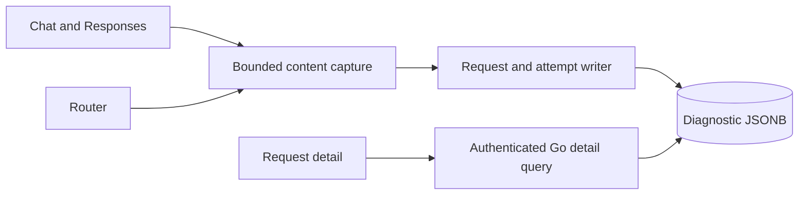
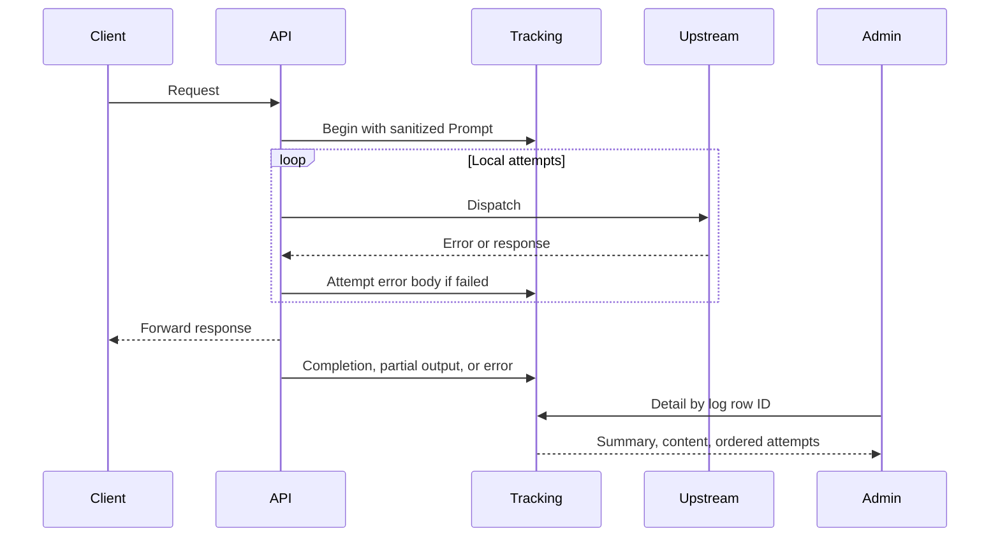

<a id="llm-request-content"></a>

# Nội dung yêu cầu LLM

Ngày: 27-09-2026 Trạng thái: đã chấp nhận

<a id="decision"></a>

## Phán quyết

store chẩn đoán prompt, Nội dung hoàn thành và lỗi với theo dõi yêu cầu. Giữ văn bản, lệnh gọi công cụ, suy luận và các trường JSON khác. Thay thế byte phương tiện nội tuyến bằng siêu dữ liệu. Không tìm nạp URL phương tiện từ xa. Không bao giờ có tiêu đề thu nhận dữ liệu HTTP. Thuộc tính bề mặt, phân tích Hoạt động và các thay đổi về thanh toán nằm ngoài phạm vi.

prompt là phần yêu cầu được chấp nhận trước khi định tuyến cổng. Hoàn thành là phản hồi upstream JSON hoặc các sự kiện dữ liệu SSE được đặt hàng, bao gồm cả đầu ra một phần. Đây không phải là bằng chứng cho thấy máy khách đã nhận được từng byte. Mỗi lần thử cục bộ thất bại vẫn giữ phần nội dung lỗi của nó, ngay cả khi một lần thử khác thành công. Lỗi transport có thông báo chứ không phải phần thân upstream được phát minh.

Sử dụng các cột JSONB có thể rỗng theo hàng yêu cầu và thử. Một phong bì chứa định dạng, văn bản, trạng thái và missedMedia. Nội dung lịch sử bị thiếu vẫn không có giá trị. Người viết giới hạn mỗi phong bì với 8 MiB của văn bản UTF-8 và đánh dấu phần cắt bớt. SSE store ghi lại sự kiện hoàn chỉnh đến mức giới hạn, không phải là đoạn JSON không hợp lệ. Các luồng bị gián đoạn sẽ giữ lại các sự kiện đã ghi ở trạng thái một phần. Nội dung chia sẻ lưu giữ chẩn đoán. Mức tăng này không bổ sung thêm bộ lập lịch lưu giữ hoặc chèn lấp lịch sử tự động. Nội dung không phải là bằng chứng giải quyết.

Chỉ chi tiết Quản trị viên Go đã được xác thực API mới hiển thị nội dung. Danh sách chọn cột tóm tắt. AIRI DTO dành cho chủ sở hữu tiếp tục loại trừ nội dung và thông tin xác thực. Ghi chẩn đoán cuối cùng giữ nguyên chính sách nỗ lực tốt nhất hiện có. Lỗi lưu trữ được ghi lại mà không bao gồm nội dung và không gửi lại tác phẩm upstream.

<a id="architecture"></a>

## Ngành kiến ​​​​trúc



```text
server/apps/api/
  src/services/domain/request-content.ts
  src/services/domain/{generation-observation,request-log}.ts
  src/services/domain/llm-router/{attempt,router}.ts
  src/routes/openai/v1/operations/{chat-completions,responses}/index.ts
  src/schemas/llm-request-{log,attempt}.ts
  drizzle/0029_llm_request_content.sql
```



<a id="verification-and-rollout"></a>

## Xác minh và triển khai

Kiểm tra JSON và SSE thu nhận dữ liệu, bảo quản tool/reasoning, thiếu sót phương tiện, có giới hạn thu nhận dữ liệu, nội dung không đúng định dạng, lần thử không thành công, hủy bỏ và giá trị rỗng lịch sử. Xác minh các lần đọc chi tiết chỉ dành cho quản trị viên và danh sách nhẹ không thay đổi. Triển khai quá trình di chuyển và ghi AIRI trước Go bên đọc, sau đó triển khai bảng thông tin. Không có hoạt động di chuyển hoặc triển khai trực tiếp nào được ủy quyền bởi tác vụ triển khai này.
