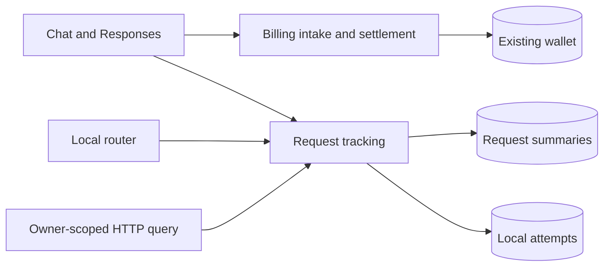
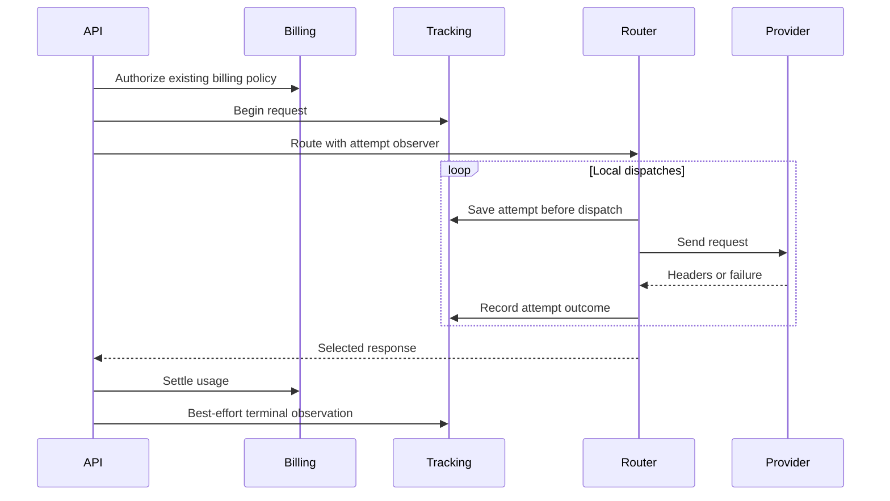

<a id="extensible-llm-request-tracking"></a>

# Theo dõi yêu cầu LLM có thể mở rộng

Ngày: 27-09-2026 Trạng thái: đã chấp nhận

<a id="decision-and-scope"></a>

## Quyết định và phạm vi

Tách theo dõi chẩn đoán khỏi quyết toán chi phí nhà cung cấp. Thay đổi này nhắm mục tiêu chính. Việc thanh toán PR phụ thuộc vào nền tảng theo dõi này. Việc theo dõi sở hữu hợp đồng quan sát được chia sẻ và trích xuất việc sử dụng, không phải giá cả hoặc ví thay đổi trạng thái. Nó không nhập cũng như không truy vấn bộ nhớ giải quyết. Flux được tính phí trong chẩn đoán chỉ mang tính quan sát chứ không phải là nguồn tính toán chính xác.

<a id="data-ownership"></a>

## Quyền sở hữu dữ liệu

- `llm_request_log`: một bản tóm tắt cho mỗi người dùng và yêu cầu ID, mối tương quan vô hiệu đối với các hàng lịch sử, vòng đời yêu cầu, mô hình đã chọn, mức sử dụng, thời gian và thứ nguyên.
- `llm_request_attempt`: một công văn cục bộ cho mỗi yêu cầu và trình tự, tham chiếu route/credential, cổng, trạng thái và bằng chứng nhà cung cấp.
- `flux_transaction` và `user_flux`: sổ cái và ví hiện có, không thay đổi ở đây.
- Bộ nhớ thanh toán thuộc về PR thanh toán sau này, không thuộc về quá trình di chuyển này.

Không có khóa ngoại xếp tầng nào kết hợp lưu giữ chẩn đoán với lưu giữ kế toán. Việc xóa các hàng chẩn đoán không thể xóa bằng chứng hoặc cho phép yêu cầu đã giải quyết tính phí hai lần. Đã được phiên bản, các quan sát có giới hạn JSON giúp mở rộng các trường cổng mới. Các trường được truy vấn thường xuyên có các cột dành riêng. Thông tin upstream chưa biết vẫn không có giá trị. Chỉ các công văn được router này quan sát mới trở thành lần thử; thử lại cổng ẩn không được phát minh.

<a id="architecture"></a>

## Ngành kiến ​​​​trúc





Các tập tin bị ảnh hưởng:

```text
server/apps/api/
  src/app.ts
  src/routes/llm-requests/index.ts
  src/routes/openai/v1/{model-routing,operations}/
  src/services/domain/request-log.ts
  src/services/domain/llm-router/{attempt,router,types}.ts
  src/schemas/{llm-request-log,llm-request-attempt}.ts
  drizzle/0026_llm_request_tracking.sql
```

<a id="lifecycle-and-failures"></a>

## Vòng đời và những thất bại

Trạng thái yêu cầu chuyển từ trạng thái đang chạy sang hoàn thành, không thành công, bị hủy hoặc bị gián đoạn khi đường dẫn yêu cầu quan sát thấy kết quả. Các nỗ lực bắt đầu khi đang chạy, có thể nhận được tiêu đề và kết thúc khi không thành công hoặc quan sát cuối cùng của yêu cầu đã chọn. Hoạt động khôi phục lỗi cũ rõ ràng đánh dấu việc chạy các quan sát không xác định mà không phát minh ra thời gian kết thúc, mức sử dụng hoặc chi phí. Nó không gửi lại yêu cầu hoặc thay đổi các khu định cư. Không có lịch trình phục hồi trong thay đổi này. Sự kiên trì của Request/attempt được chờ đợi trước khi gửi đi. Lỗi theo dõi sẽ dừng gửi đi thay vì chạy thử lại không được theo dõi. PR thanh toán sau sẽ bổ sung thêm lượng tiêu thụ của riêng mình. Việc theo dõi không tạo ra các hàng kế toán đang chờ xử lý. Việc ghi chẩn đoán cuối cùng vẫn phải nỗ lực hết sức và không khôi phục lại quá trình giải quyết đã hoàn thành.

<a id="query-boundary"></a>

## Ranh giới truy vấn

Các API trong phạm vi chủ sở hữu đã được xác thực sẽ hiển thị `/api/v1/llm-requests` và `/api/v1/llm-requests/:requestId`. Mọi yêu cầu và truy vấn thử đều bao gồm quyền sở hữu của người dùng. API này không hiển thị dữ liệu lún. DTO bỏ qua bằng chứng thô, tài liệu tham khảo thông tin xác thực và ảnh chụp nhanh giá nội bộ. Danh sách sử dụng phân trang bù có giới hạn. Không bao gồm API người dùng chéo quản trị viên hoặc Hoạt động UI.

<a id="rollout-and-non-goals"></a>

## Triển khai và ngoài phạm vi

Hợp nhất PR này trước. Sau đó, PR thanh toán sẽ bổ sung thêm quá trình di chuyển 0027 riêng biệt. PR này chỉ cung cấp di chuyển theo dõi 0026. 0025 hiện tại của Main không thay đổi. Các hàng lịch sử vẫn có thể đọc được khi không có thứ nguyên mới. Không bịa đặt mối tương quan lịch sử hoặc sự thật nhà cung cấp. Đây không phải là đường dẫn nâng cấp từ bản dự thảo di chuyển kết hợp chưa được xuất bản trước đó. PR này duy trì hành vi thanh toán của chính. Thanh toán phụ thuộc PR loại bỏ chính sách giá LLM cũ. Không có nội dung prompt/completion đầy đủ, tra cứu cổng tự động, quy trình cổng độc lập, công việc lưu giữ hoặc bảng thông tin được thêm vào. OpenRouter và các cổng khác có thể nhận được bộ điều hợp và siêu dữ liệu mà không thay đổi ranh giới thanh toán.

<a id="verification-plan"></a>

## Kế hoạch xác minh

Lỗi đầu vào của máy khách trả về 400. Kết quả yêu cầu tuân theo trạng thái đã gửi, bao gồm upstream JSON không đúng định dạng và từ chối giải quyết; các lần thử vẫn giữ trạng thái tiêu đề upstream của chúng. Bộ đếm định tuyến bí danh bao gồm tất cả các ứng viên. Responses duy trì các kích thước tương tác giống như Chat Completions.

- Vòng đời yêu cầu và thử, kết quả thử lại cục bộ và cách ly quyền sở hữu.
- DTO truy vấn an toàn, lịch sử vô hiệu, có giới hạn và bằng chứng nhà cung cấp đã được khử trùng.
- Việc ghi và lưu giữ chẩn đoán không bao giờ thay đổi trạng thái ví hoặc sổ cái.
- Quá trình theo dõi biên dịch và chạy mà không cần lưu trữ thanh toán.
- Áp dụng cả hai lần di chuyển theo thứ tự, bảo tồn các hàng lịch sử và kế toán ổn định.
- HTTP route thực với PGlite, bộ hồi quy thanh toán, workspace kiểm tra kiểu dữ liệu và lint.
- Việc triển khai sản xuất và lưu lượng trực tiếp nhà cung cấp vẫn chưa được xác minh.
