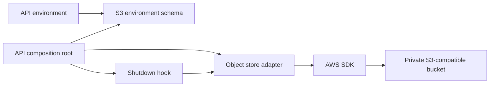
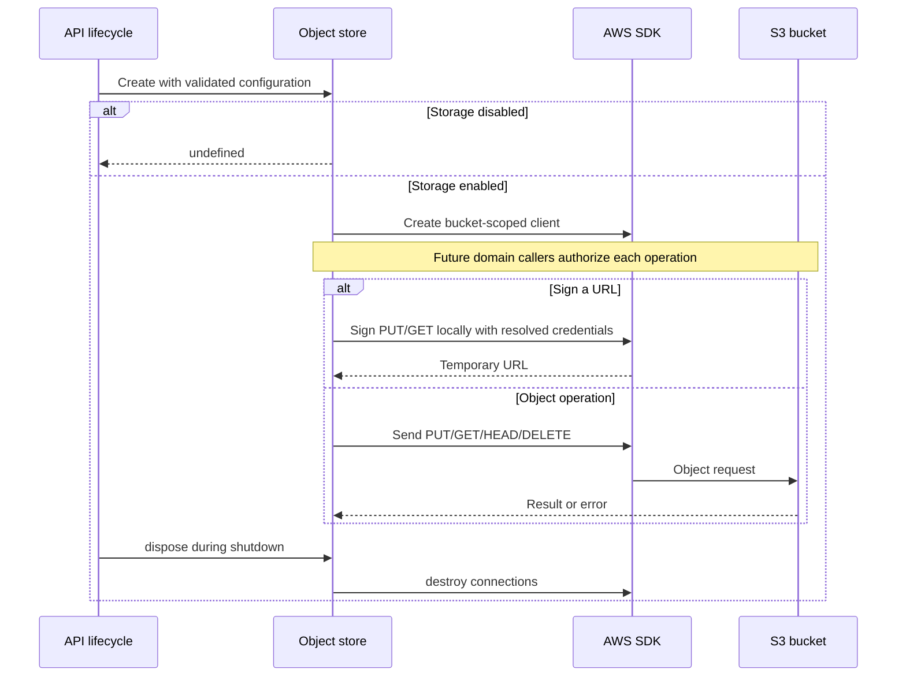

<a id="optional-s3-object-storage-for-the-api"></a>

# Bộ lưu trữ đối tượng S3 tùy chọn cho API

Tình trạng: đề xuất

<a id="decision"></a>

## Phán quyết

Thêm bộ điều hợp S3 tùy chọn, trong phạm vi bucket vào API. Sử dụng AWS SDK chính thức được chọn trong tác phẩm đính kèm trước đó (#2636). Bộ điều hợp sở hữu đối tượng transport và chữ ký URL tồn tại trong thời gian ngắn. Dịch vụ miền sở hữu khóa, ủy quyền, siêu dữ liệu và quy tắc hoàn tất tải lên. Ứng dụng sở hữu một máy khách và hủy kết nối của nó khi tắt máy. Thiếu cấu hình sẽ vô hiệu hóa việc lưu trữ. Cấu hình một phần không khởi động được.

<a id="scope"></a>

## Phạm vi

Hỗ trợ tải lên máy chủ, tải xuống trực tuyến, HEAD, xóa và URL PUT/GET được chỉ định. Hỗ trợ các điểm cuối tùy chỉnh và các yêu cầu kiểu đường dẫn tùy chọn cho các dịch vụ như MinIO. Sử dụng chuỗi thông tin xác thực mặc định AWS, bao gồm các biến môi trường AWS tiêu chuẩn và vai trò IAM. Không xác định các biến thông tin xác thực S3 riêng biệt. Sử dụng cấu hình vùng rõ ràng khi bật bộ nhớ. Các URL đã ký có thời gian tồn tại cố định là 900 giây.

<a id="non-goals"></a>

## Ngoài phạm vi

PR này không thêm điểm cuối HTTP công khai, bảng đính kèm, thay đổi giao thức đồng bộ hóa đám mây hoặc cung cấp bucket. Nó độc lập với #2636. PR đó có thể sử dụng bộ chuyển đổi này trong lần thay đổi sau. Người gọi tên miền phải ủy quyền các yêu cầu trước khi ký URL. URL đã ký là thông tin xác thực mang tính tạm thời và không được nhập các hồ sơ hoặc nhật ký lâu dài.

<a id="modules"></a>

## Mô-đun



```text
server/apps/api/
├── src/libs/env.ts                        # Validates startup configuration
├── src/services/adapters/s3-config.ts     # Owns S3 configuration rules
├── src/services/adapters/object-store.ts  # Owns object transport and signing
├── src/app.ts                            # Owns client lifetime
└── README.md                             # Documents deployment and callers
```

<a id="behavior"></a>

## Hành vi



GET trả về luồng SDK. Người gọi nó phải sử dụng hoặc hủy luồng để giải phóng kết nối. Lỗi lưu trữ lan truyền đến người gọi tên miền. Bộ điều hợp không chuyển đổi các lần đọc thất bại thành các đối tượng trống. Tắt máy tuân theo vòng đời ứng dụng hiện có. Người gọi phải dừng yêu cầu và sử dụng luồng trước khi xử lý ứng dụng khách. Bộ điều hợp bảo toàn chính xác các khóa đối tượng và không bao giờ lấy chúng từ các đường dẫn HTTP không đáng tin cậy.

<a id="test-plan"></a>

## kế hoạch kiểm tra

- Xác thực cấu hình và điểm cuối bị vô hiệu hóa, hoàn chỉnh và không đầy đủ.
- Xác minh việc đăng nhập thông qua thông tin đăng nhập môi trường AWS tiêu chuẩn, bao gồm cả phiên token, với thời gian hết hạn cố định là 900 giây.
- Thực hiện việc ký SDK thực tế bằng thông tin xác thực kiểm tra xác định và xác minh các tiêu đề cũng như chế độ địa chỉ đã ký.
- Thực hiện các yêu cầu đối tượng thông qua máy chủ HTTP cục bộ và xác minh byte, siêu dữ liệu, lỗi và mức tiêu thụ luồng.
- Thực hiện MinIO bucket dùng một lần, bao gồm tải lên trực tiếp và từ chối các tiêu đề đã ký đã thay đổi.
- Chạy API kiểm tra kiểu dữ liệu, kho lưu trữ kiểm tra kiểu dữ liệu và kho lưu trữ lint.
- Thông tin xác thực sản xuất, quyền bucket và trình duyệt CORS yêu cầu xác minh cụ thể theo triển khai.
