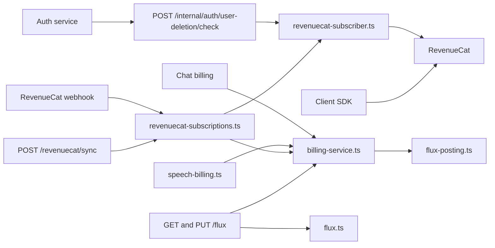
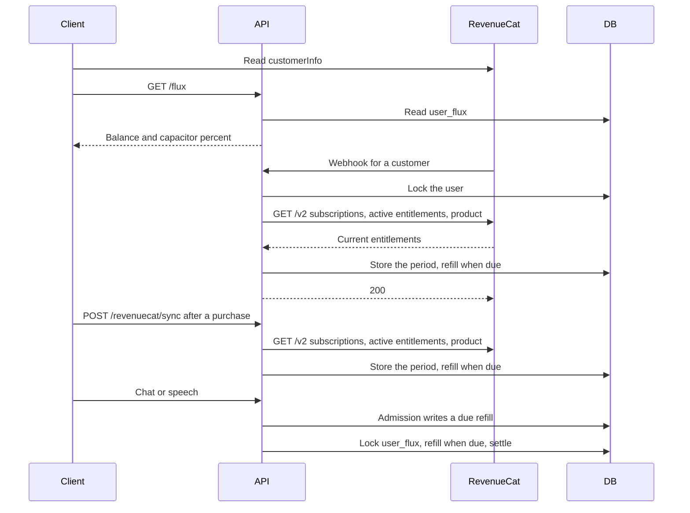

<a id="the-capacitor"></a>

# Capacitor

Trạng thái: đã chấp nhận

<a id="decision"></a>

## Phán quyết

RevenueCat là nguồn cho trạng thái quyền lợi. Cơ sở dữ liệu cục bộ không có trạng thái đăng ký store và không có các sự kiện webhook store.

Ứng dụng đọc `customerInfo` trong ứng dụng khách SDK cho Capacitor hiện tại, thời hạn sử dụng và quản lý URL. Máy chủ đọc RevenueCat REST API v2 để cấp Capacitor Flux. Nó đọc các đăng ký của khách hàng, các quyền hiện có và sản phẩm của mỗi đăng ký cấp quyền truy cập. Đăng ký sẽ bắt đầu thời hạn thanh toán, quyền hiện hoạt sẽ kết thúc quyền truy cập và sản phẩm sẽ cung cấp mã định danh store. API v2 báo cáo `status` và `auto_renewal_status`, vì vậy máy chủ không suy luận gì về ngày tháng. Một khách hàng mà RevenueCat không biết thì không có đăng ký.

Capacitor Flux là bucket thứ hai trong ví Flux. Nó không phải là một hệ thống thanh toán thứ hai. `user_flux` giữ cả bucket trong một hàng:

- `flux` được mua Flux. Nó không hết hạn.
- `capacitor_flux` là Capacitor Flux. Nó nạp lại hạn ngạch ở mỗi ranh giới đặt lại.
- `capacitor_quota`, `capacitor_expires_at` và `capacitor_period_start` mô tả kỳ thanh toán hiện tại.
- `capacitor_filled_at` là thời điểm nạp lại lần cuối.
- `capacitor_reset_at` là thời gian đặt lại quản trị viên cho ví này.
- `fallback_to_flux` chọn xem Flux đã mua có thanh toán hay không sau khi Capacitor Flux hết. Mặc định là tắt.

Một Flux bằng 1.000.000 micro-Flux trong cả bucket.

<a id="spend"></a>

### Tiêu

`postFluxUsage` là đường dẫn ghi nợ duy nhất. Nó giữ tính bình thường của `flux_usage` và khóa hàng ví. Việc thanh toán sẽ lấy toàn bộ Flux từ Capacitor trước tiên. Phần còn lại đến từ Flux đã mua khi người dùng không bật Capacitor hoặc `fallback_to_flux` đang hoạt động. Một khoản phí có thể sử dụng cả bucket. Một khoản phí mà không bucket nào có thể trả vẫn còn tồn đọng, như trước đây. Một khoản trợ cấp Capacitor sau này hoặc credit sẽ trả số tiền đó.

Tuyển sinh sử dụng quy tắc tương tự. Nó đếm số bucket có thể thanh toán ngay bây giờ.

<a id="grant"></a>

### Khoản trợ cấp

Máy chủ không chọn quy tắc từ loại sự kiện webhook. Webhook chỉ cho máy chủ biết rằng khách hàng đã thay đổi. Máy chủ đọc quyền lợi của khách hàng và gọi `BillingService.syncCapacitor`. `POST /api/v1/revenuecat/sync` chạy điều chỉnh tương tự cho người dùng đã đăng nhập. Khách hàng gọi nó sau khi mua hàng và khi trang Capacitor mở ra. Do đó, webhook muộn không từ chối yêu cầu đầu tiên của người đăng ký mới và webhook bị mất sẽ được sửa chữa trong lần truy cập trang tiếp theo. route cho phép mỗi người dùng thực hiện 10 cuộc gọi trong một phút vì mỗi cuộc gọi đều đọc RevenueCat. Giao dịch mua mới nhất sẽ thắng khi hai Tụ điện được ánh xạ đang hoạt động.

`syncCapacitor` store hạn ngạch, thời hạn sử dụng và thời gian bắt đầu. Nó không cấp Flux trực tiếp.

Khi webhook tạo ví đầu tiên, hệ thống giữ `INITIAL_USER_FLUX` và ghi bản ghi sổ cái ban đầu trong cùng giao dịch. Việc đọc số dư và webhook dùng chung thao tác khởi tạo ví. Webhook được gửi lại không cấp số dư ban đầu thêm lần nữa. Quy tắc nạp lại bên dưới quyết định số dư được cấp. Hạn ngạch nhỏ hơn giới hạn dung lượng bộ tích lũy. Thao tác giới hạn ghi bản ghi sổ cái `capacitor_quota_cap` trong cùng giao dịch. Khi không có Capacitor đang hoạt động, `capacitor_expires_at` được đặt bằng thời điểm hiện tại.

Các quy tắc này bao gồm mua hàng, gia hạn, thay đổi sản phẩm, gia hạn, hết hạn, hoàn tiền và chuyển nhượng. Việc gửi lặp lại hoặc giao hàng trễ đều cho kết quả như nhau nên máy chủ không lưu giữ nhật ký sự kiện. `TRANSFER` đặt tên cho người dùng của mình trong `transferred_from` và `transferred_to`. Máy chủ hòa giải từng người trong số họ. Capacitor không hết hạn sẽ không được bán và không cấp Flux.

`syncCapacitor` giữ khóa tư vấn Postgres cho người dùng trong khi đọc RevenueCat. Hai webhooks cho một người dùng không thể viết câu trả lời cũ hơn sau câu trả lời mới hơn. Hàng ví vẫn được mở khóa trong quá trình đọc, do đó việc ghi nợ vẫn tiếp tục. Quá trình đọc có thời gian chờ 5 giây.

Máy chủ không điều chỉnh khi `REVENUECAT_CAPACITORS` không được đặt hoặc trống. Ví vẫn giữ nguyên như cũ. Đồng bộ hóa không có sản phẩm sẽ hết hạn sau mỗi Capacitor hoạt động. Webhook trả về lỗi khi đọc không thành công hoặc khi `REVENUECAT_V2_API_KEY` hoặc `REVENUECAT_PROJECT_ID` không được đặt. RevenueCat sau đó gửi lại sự kiện. Sự kiện `TEST` không đọc RevenueCat. RevenueCat chỉ bán Tụ điện. Các gói Flux vẫn có trên Stripe và Apple IAP.

<a id="refill"></a>

### Nạp tiền

Một quy tắc điền vào Capacitor. Việc nạp lại sẽ đến hạn khi `capacitor_filled_at` ở trước ranh giới đặt lại của Capacitor đang hoạt động. Ranh giới là mới nhất trong số những thời điểm này:

- `capacitor_period_start`.
- Bắt đầu cửa sổ đặt lại hiện tại, khi `CAPACITOR_RESET_INTERVAL` là `day` hoặc `week`. Số lượng Windows tính từ thời điểm bắt đầu.
- `CAPACITOR_RESET_AT`, thiết lập lại một lần cho mọi ví.
- `capacitor_reset_at`, thiết lập lại một lần cho một ví.

Thời gian đặt lại trong tương lai không được tính cho đến khi nó trôi qua. Việc nạp tiền sẽ đặt `capacitor_flux` thành `capacitor_quota`. Capacitor Flux không sử dụng sẽ bị hủy. Một ranh giới không muộn hơn lần nạp cuối cùng sẽ không được nạp lại. Do đó, việc quay trở lại thời hạn thanh toán trước đó sẽ giữ nguyên số tiền đã chi tiêu.

Không có công việc chạy nạp tiền. Tuyển sinh viết một lần nạp tiền khi nó đọc ví. Nó giải quyết các khoản phí còn tồn đọng trong cùng một giao dịch, theo khóa hàng ví. Một thỏa thuận giải quyết viết một khoản nạp tiền đến hạn theo cách tương tự. Việc nhập học phải viết thêm tiền, bởi vì yêu cầu bị từ chối sẽ không bao giờ được giải quyết. Một lần nạp tiền chỉ được tính sẽ trả lại khoản phí chưa thanh toán tương tự sau mỗi lần đặt lại. Một lần đặt lại cho mỗi ví là một lần ghi ConfigKV.

Các công cụ quản trị viết `CAPACITOR_RESET_INTERVAL`, `CAPACITOR_RESET_AT` và `capacitor_reset_at`. API này không có quản trị viên route cho họ.

Tụ điện được bán theo tháng. Khách hàng chỉ liệt kê các gói có thời hạn thanh toán hàng tháng.

Một khoản phí mà Capacitor không thể thanh toán vẫn còn tồn đọng trong khi phương án dự phòng tắt. Switch phương án dự phòng không hủy khoản phí đó. Lần nạp tiền tiếp theo sẽ thanh toán số tiền đó hoặc Flux đã mua sẽ thanh toán số tiền đó sau khi Capacitor hết hạn. Một yêu cầu có thể vượt quá số dư một lượng nhỏ, giống như trong ví trước Tụ điện.

<a id="expiry"></a>

### Hết hạn

Mỗi lần đọc thẩm phán hết hạn. Capacitor có `capacitor_expires_at` trong quá khứ được tính là 0. Không có công việc nào xóa nó.

<a id="read"></a>

### Đọc

`GET /api/v1/flux` trả về `capacitorPercent`, `capacitorRechargesAt` và `fallbackToFlux` cùng với số dư. `capacitorRechargesAt` là điểm bắt đầu của cửa sổ đặt lại tiếp theo. Nó là vô giá trị nếu không có khoảng thời gian đặt lại vì Capacitor sau đó chỉ sạc lại khi gia hạn. Số lượng Windows tính từ thời điểm bắt đầu chu kỳ của mỗi người dùng, vì vậy máy khách sẽ hiển thị thời gian này. Phần trăm là `capacitor_flux / capacitor_quota`. Nó là vô giá trị nếu không có Capacitor hoạt động. Số dư được lưu trong bộ nhớ cache có thể hiển thị số tiền trước khi đặt lại trong 60 giây. Phản hồi bỏ qua số lượng Capacitor Flux. `PUT /api/v1/flux/fallback` lưu `fallbackToFlux`. `GET /api/v1/revenuecat/capacitors` trả về id sản phẩm trong `REVENUECAT_CAPACITORS`. Khách hàng chỉ liệt kê những sản phẩm này. Việc mua một sản phẩm khác sẽ phải thanh toán và không cấp Capacitor Flux. Trò chuyện và lời nói không gọi RevenueCat.

<a id="ledger"></a>

### Sổ cái

`flux_transaction.pool` là `wallet` hoặc `capacitor`. Các cột cân bằng của một hàng mô tả bucket trong `pool`. Lần nạp lại là một hàng `credit` trong nhóm Capacitor. `balanceBefore` của nó là Capacitor Flux bị tịch thu. Một giải pháp sử dụng cả bucket ghi một hàng `debit` cho mỗi nhóm. Đã mua dung lượng Flux và `GET /flux/history` chỉ đọc nhóm ví.

Giao dịch mua trên web SDK không thể thay thế đăng ký trong ứng dụng. Thuê bao mở URL quản lý để thay đổi Tụ điện. Webhook áp dụng Capacitor Flux mới sau khi store thay đổi sản phẩm.

<a id="account-deletion"></a>

### Xóa tài khoản

Người dùng đã xóa không thể mở URL quản lý, vì vậy đăng ký vẫn có thể tính phí sẽ từ chối xóa. Máy chủ không hủy đăng ký. Người dùng hủy nó và sau đó xóa tài khoản. Quy tắc này cũng bao gồm các đăng ký Ứng dụng store và Google Play mà máy chủ không thể hủy.

Thuê bao vẫn có thể tính phí trừ khi `status` của nó là `expired` hoặc `incomplete` hoặc `auto_renewal_status` của nó là `will_not_renew`. Đối với trạng thái `unknown`, trạng thái gia hạn sẽ quyết định. Đăng ký khuyến mại không có sản phẩm nên không cấp Capacitor. Vì vậy, một thuê bao bị hủy không từ chối. Nó giữ quyền truy cập cho đến khi thời gian kết thúc và việc xóa sẽ xóa ví. Đăng ký trong `in_billing_retry` từ chối. Nó không cấp quyền truy cập nhưng khoản thanh toán đã thu hồi sẽ tính phí cho khách hàng.

Dịch vụ Auth hỏi `POST /internal/auth/user-deletion/check` trên mạng riêng. Việc kiểm tra không thay đổi gì cả. Nó trả về 409 `SUBSCRIPTION_ACTIVE` khi bị từ chối. Sau đó, Auth trả về lỗi Better Auth `SUBSCRIPTION_ACTIVE` mà trang tài khoản hiển thị. Auth hỏi ở hai điểm:

- Trước khi yêu cầu xóa gửi email xác nhận. Better Auth `before` hook trên `/delete-user` chạy kiểm tra vì lệnh gọi lại email có thể chạy ở chế độ nền.
- Đầu tiên là trong `beforeDelete`, trước khi nó thu hồi các ủy quyền bên ngoài. Người dùng có thể đăng ký sau email.

Việc dọn dẹp tài nguyên không có quy tắc đăng ký. Việc từ chối sau khi thu hồi sẽ khiến tài khoản không có trợ cấp xã hội. Việc đọc RevenueCat không thành công sẽ từ chối xóa. Nếu không có khóa API v2 hoặc id dự án, quá trình kiểm tra sẽ vượt qua khi không có bí mật webhook nào được đặt vì quá trình triển khai đó không bán đăng ký. Với bí mật webhook, cấu hình bị thiếu là lỗi và kiểm tra trả về 503.

<a id="scope"></a>

## Phạm vi

Xóa bản sao trạng thái đăng ký cục bộ và nhật ký sự kiện webhook. Đọc trạng thái quyền được hưởng từ RevenueCat trên máy khách và trên máy chủ. Giữ Capacitor Flux trong ví Flux.

<a id="non-goals"></a>

## Ngoài phạm vi

Capacitor Flux Recall trong khoảng thời gian vẫn hoạt động. Một công việc hòa giải không có webhook. Hiển thị số tiền Capacitor Flux trên thẻ Capacitor. Tụ điện hàng năm. Flux đóng gói thông qua RevenueCat. Một quản trị viên route trong API này để đặt lại. Kiểm tra thay thế sản phẩm trong ứng dụng. Các lô hết hạn dành cho Flux đã mua.

<a id="module-graph"></a>

## Biểu đồ mô-đun



<a id="sequence"></a>

## Sự liên tiếp



<a id="affected-files"></a>

## Các tập tin bị ảnh hưởng

```text
server/apps/api/
  drizzle/0032_capacitor.sql
  src/schemas/{flux,flux-transaction}.ts
  src/services/domain/billing/{billing-service,flux-posting}.ts
  src/services/domain/{flux,flux-cache,flux-transaction}.ts
  src/services/adapters/revenuecat-subscriber.ts
  src/services/adapters/revenuecat-subscriptions.ts
  src/routes/flux/index.ts
  src/routes/revenuecat/index.ts
  src/routes/revenuecat/operations/webhook.ts
packages/stage-ui/src/stores/auth.ts
packages/stage-ui/src/composables/use-subscription.ts
packages/stage-pages/src/pages/settings/capacitor.vue
```

<a id="test-plan"></a>

## kế hoạch kiểm tra

Chạy thử nghiệm Capacitor Flux cho một khoảng thời gian mới, một khoảng thời gian đã biết, một khoảng thời gian đã thay đổi, một khoảng thời gian trước đó, không có khoảng thời gian và hết hạn. Chạy thử nghiệm đặt lại cho khoảng thời gian, đặt lại cho mọi ví, đặt lại cho một ví và Capacitor đã hết hạn. Chạy thử nghiệm độ thanh toán cho đơn hàng đầu tiên Capacitor, có tính phí trên cả bucket và bộ chuyển đổi phương án dự phòng. Chạy các bài kiểm tra ứng dụng khách đăng ký RevenueCat để tham gia đăng ký, quyền và sản phẩm, cho các trang cũng như các lỗi upstream. Chạy thử nghiệm đồng bộ hóa đăng ký RevenueCat để lựa chọn Capacitor. Chạy kiểm tra webhook cho một sự kiện lặp lại, `PRODUCT_CHANGE`, `EXPIRATION`, `TRANSFER` và đọc không thành công. Chạy các bài kiểm tra Flux route để biết phần trăm Capacitor và lựa chọn phương án dự phòng. Chạy thử nghiệm máy khách để ánh xạ `customerInfo` tới Capacitor hiện tại. Chạy bài kiểm tra đầu vào để nạp tiền đúng hạn với một khoản phí chưa thanh toán. Chạy thử nghiệm route để đồng bộ hóa người dùng đã đăng nhập, đồng bộ hóa ẩn danh và danh sách sản phẩm. Chạy thử nghiệm máy khách của người đăng ký cho từng trạng thái gia hạn, cho `in_billing_retry` và cho cấu hình bị thiếu. Chạy các bài kiểm tra route nội bộ để kiểm tra việc xóa. Chạy kiểm tra xác thực cho yêu cầu bị từ chối không có email và đối với liên kết email bị từ chối mà không bị thu hồi. Chạy thử nghiệm máy khách để đồng bộ hóa trước khi đọc số dư và cho bộ lọc sản phẩm.
