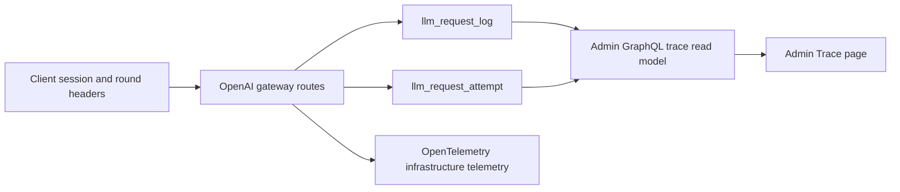
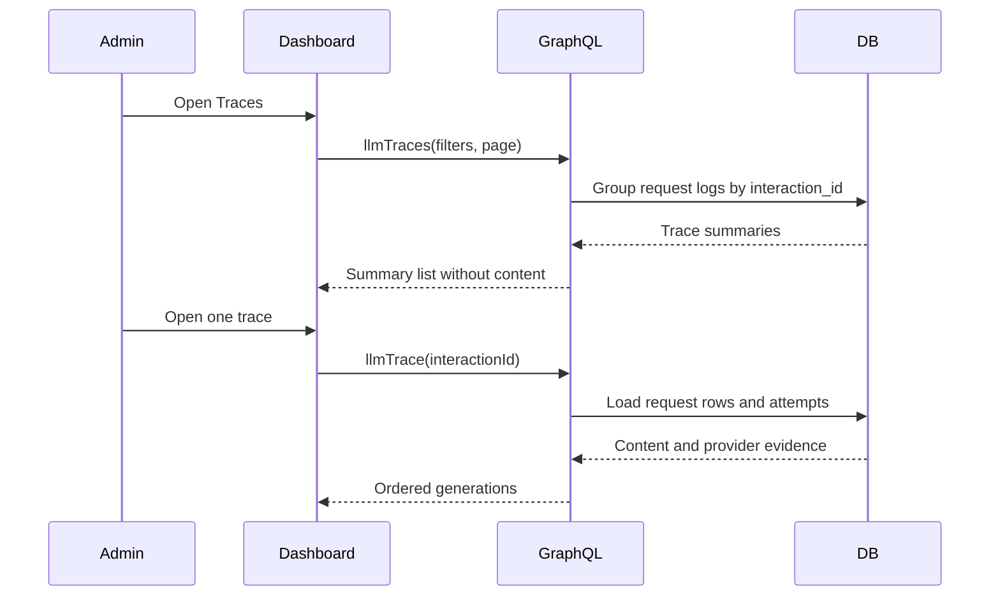

<a id="admin-agent-traces-from-request-logs"></a>

# Dấu vết quản trị viên agent từ nhật ký yêu cầu

Trạng thái: đã chấp nhận

<a id="decision"></a>

## Phán quyết

Trang Trace của quản trị viên ghi agent lượt từ `llm_request_log`. Một dấu vết là một `interaction_id` không trống. Một sinh nội dung là một hàng nhật ký yêu cầu. Một lần thử upstream là một hàng `llm_request_attempt`.

Nhật ký yêu cầu vẫn là nguồn của prompt, dữ liệu hoàn thành, mô hình, token, nhà cung cấp, trạng thái và dữ liệu thời gian. Quản trị viên API nhóm các hàng này cho trang Theo dõi. Thay đổi này không thêm bảng theo dõi và không có đường dẫn ghi thứ hai.

Xóa trình xuất Langfuse và trình bao bọc sinh nội dung của nó khỏi API. Giữ quy trình OpenTelemetry để theo dõi, số liệu và nhật ký cơ sở hạ tầng. OpenTelemetry không nhận được prompt hoặc nội dung hoàn thành.

<a id="boundary"></a>

## ranh giới

```text
client session ID      -> llm_request_log.session_id
client round ID        -> llm_request_log.interaction_id
LLM gateway request    -> llm_request_log
upstream dispatch      -> llm_request_attempt
admin Trace page       -> grouped read model
```

Máy khách đã gửi phiên ID và làm tròn ID. API không cần sự kiện khách hàng mới cho trang Theo dõi đầu tiên. Cần có một sự kiện khách hàng trong tương lai để phát lại công cụ chính xác runtime, ASR, TTS và thời gian IO cục bộ.

<a id="scope"></a>

## Phạm vi

- Xóa các gói Langfuse, thiết lập nhà xuất khẩu và các lệnh gọi sinh nội dung.
- Thêm truy vấn quản trị viên để có bản tóm tắt theo dõi và chi tiết theo dõi.
- Nhóm các yêu cầu theo `interaction_id` mà không cần sao chép hàng.
- Chỉ hiển thị nội dung yêu cầu đầy đủ trong chi tiết theo dõi.
- Thêm điều hướng giữa các phiên, dấu vết và yêu cầu.

<a id="non-goals"></a>

## Ngoài phạm vi

- Không thêm ứng dụng khách tải lên IOTrace.
- Không suy ra chính xác thời gian sử dụng dao hoặc mức độ thành công của dao.
- Không đặt prompt hoặc nội dung hoàn thành trong các nhịp OpenTelemetry.
- Không di chuyển dữ liệu lịch sử.
- Không thay đổi yêu cầu thanh toán hoặc định tuyến.

<a id="module-graph"></a>

## Biểu đồ mô-đun



<a id="affected-files"></a>

## Các tập tin bị ảnh hưởng

```text
server/apps/api/
  instrumentation.ts
  package.json
  README.md
  src/routes/openai/v1/
  src/services/domain/openai-speech/
  src/services/domain/llm-tracing/ (remove)
server/docs/ai/adr/2026-10-05-admin-agent-traces.md
pnpm-lock.yaml

proj-airi/backend/
  api/graphql/admin/schema/llm.graphqls
  internal/models/llmlog/
  internal/graphql/admin/resolver/

proj-airi/admin-dashboard/
  src/graphql/llm.graphql
  src/pages/observability/
  src/components/observability/
  src/components/admin/navigation.ts
  src/router.ts
```

<a id="read-sequence"></a>

## Đọc trình tự



<a id="rollout"></a>

## Triển khai

Triển khai quản trị viên API trước bảng điều khiển. Trang tổng quan cũ không gọi các trường mới. Triển khai AIRI API sau khi trang Theo dõi có sẵn. Việc xóa Langfuse sẽ dừng các quan sát bên ngoài mới nhưng không xóa dữ liệu Langfuse hiện có.

Khôi phục AIRI API để khôi phục xuất Langfuse. Khôi phục bảng điều khiển một cách độc lập nếu mô hình đọc mới có vấn đề. Không cần khôi phục cơ sở dữ liệu.

<a id="verification"></a>

## Xác minh

- Kiểm tra nhóm theo dõi, bộ lọc, phân trang, sắp xếp, số lượng không thành công, token và mô hình.
- Kiểm tra xem chi tiết theo dõi có trả về lần sinh nội dung theo thứ tự thời gian với nội dung yêu cầu và số lần thử hay không.
- Chạy thử nghiệm GraphQL sinh nội dung và Go.
- Chạy bảng điều khiển GraphQL sinh nội dung, kiểm tra đơn vị, kiểm tra kiểu dữ liệu và xây dựng.
- Xác minh điều hướng phiên theo dõi, theo dõi theo yêu cầu và yêu cầu theo dõi trong trình duyệt.
- Chạy các bài kiểm tra API bao gồm trò chuyện, Responses và lời nói route sau khi loại bỏ Langfuse.
