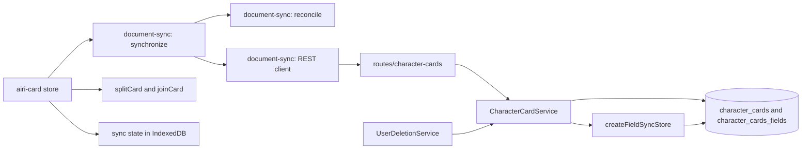
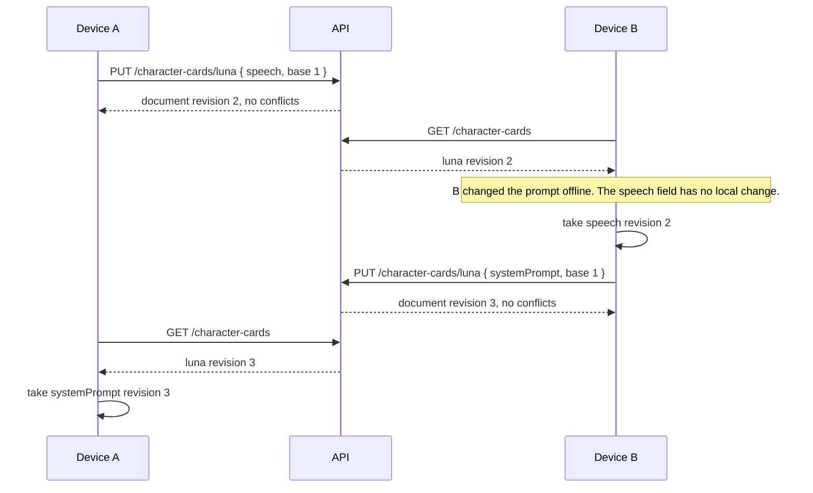

<a id="document-synchronization-by-field"></a>

# Đồng bộ hóa tài liệu theo trường

Trạng thái: đã chấp nhận

<a id="context"></a>

## Bối cảnh

Một khách hàng giữ thẻ nhân vật của mình trong bộ nhớ cục bộ. Thẻ không đến được các thiết bị khác của người dùng. Đồng bộ hóa trò chuyện store id thẻ cục bộ trong mỗi thành viên trò chuyện. Thiết bị thứ hai nhận được cuộc trò chuyện nhưng không có thẻ có id đó. Dữ liệu khách hàng khác có cùng nhu cầu, vì vậy các quy tắc xung đột phải có thể tái sử dụng được. Một bảng chia sẻ cho tất cả các tính năng không phù hợp. Mỗi tính năng có giới hạn, chỉ mục, lưu giữ và xác thực riêng.

<a id="decision"></a>

## Phán quyết

Máy chủ và máy khách chia sẻ một thuật toán chứ không phải một bảng. Mỗi tính năng sở hữu các bảng và route của nó. Máy chủ cung cấp store hoạt động trên các bảng của bất kỳ tính năng nào.

Một tài liệu là một tập hợp các trường độc lập. Máy khách tạo id tài liệu và máy chủ giữ nó. Máy khách của một tính năng chọn các trường của nó. store không đọc khóa hoặc giá trị trường. Tính năng này xác thực nội dung trước khi store ghi nội dung đó.

Mỗi tài liệu có một bộ đếm `revision`. Một bài viết được chấp nhận sẽ làm tăng nó. Bảng trường chỉ nối thêm các hàng. Mỗi hàng là giá trị mà một trường có trong một lần sửa đổi. Giá trị `null` có nghĩa là bản sửa đổi đã xóa trường này. Giá trị hiện tại của một trường là hàng có phiên bản cao nhất. Một lần đẩy sẽ mang lại `baseRevision` cho mỗi trường. store chấp nhận trường nếu bản sửa đổi được lưu trữ của giá trị hiện tại bằng nhau. store chấp nhận các trường khác của cùng một lần đẩy. Nó trả về các khóa mà nó không chấp nhận. Các thiết bị thay đổi các trường khác nhau của một tài liệu sẽ không xung đột.

Vì bảng trường giữ mọi hàng trước đây nên store cũng có thể trả lời "tài liệu này trông như thế nào ở bản sửa đổi N" và "điều gì đã thay đổi ở mỗi bản sửa đổi". Một tính năng bật tính năng này bằng cách chuyển giới hạn `history` sang `createFieldSyncStore`. store cắt bớt các hàng cũ sau mỗi lần ghi được chấp nhận, trong cùng một giao dịch, do đó, một tính năng không cần tác vụ nền.

Thiết kế không sử dụng CRDT. Giá trị là một lựa chọn hoặc một văn bản đầy đủ và việc hợp nhất hai văn bản sẽ cho kết quả mà không có người dùng nào viết.

<a id="server-modules"></a>

## Mô-đun máy chủ

| Mô-đun | Chủ sở hữu | Trách nhiệm |
| --- | --- | --- |
| `FieldSyncTables` | Đã chia sẻ | Loại liệt kê các cột mà store cần. Trình biên dịch từ chối một bảng bị thiếu. |
| `createFieldSyncStore(db, tables, { validate, limits, history })` | Đã chia sẻ | Khóa tài liệu, so sánh các bản sửa đổi, nối thêm các trường được chấp nhận, giữ lại các điểm đánh dấu xóa, cắt bớt lịch sử, trả lời `history` và `snapshot`, đồng thời xóa nội dung của tài khoản đã xóa. |
| `parseDocumentId`, `parsePushRequest`, `parseDeleteRevision`, `parseHistoryQuery`, `parseRevisionParam` | Đã chia sẻ | Phân tích năm hình dạng yêu cầu. |
| Bảng, dịch vụ, route và `validate` của một tính năng | Tính năng | Khai báo hai bảng bằng tay trong tệp lược đồ riêng của nó. Chọn route, các cột và bảng bổ sung, giới hạn, ủy quyền và mọi quy tắc về nội dung. |

Một tính năng tạo nên store trong route của chính nó. store không cung cấp route và không có các hook nào khác ngoài `validate`. Một tính năng có thể thêm route khác vào cùng một đường dẫn, ví dụ: địa chỉ tải lên đã ký cho một tệp.

Một tính năng có thể thêm cột và chỉ mục vào bảng của nó. Cột được thêm phải chấp nhận `null` hoặc có giá trị mặc định. store chèn một hàng tài liệu chỉ có hai cột chính và trình biên dịch không bắt được cột bắt buộc. Đối với giá trị bắt buộc, tính năng này sử dụng một trường hoặc bảng khác có khóa `(ownerId, documentId)`.

<a id="conflict-rules"></a>

## Quy tắc xung đột

| Trường hợp | Kết quả |
| --- | --- |
| Một bên thay đổi một lĩnh vực | Sự thay đổi đó được áp dụng. |
| Cả hai bên đều thay đổi một trường thành cùng một giá trị | Không viết. |
| Cả hai bên đã thay đổi một trường thành các giá trị khác nhau | Giá trị từ xa được áp dụng. Máy khách giữ tài liệu cục bộ như một tài liệu mới. |
| Một bên xóa tài liệu, một bên chỉnh sửa | Việc chỉnh sửa được áp dụng và tài liệu vẫn được giữ nguyên. |
| Một tài liệu mà mỗi thiết bị tạo có cùng id | Thiết bị chỉ gửi những phần khác với nội dung cài sẵn nên tài liệu chưa chỉnh sửa sẽ không gửi gì cả. Các thiết bị khác đặt các phần nhận được lên trên nội dung tích hợp sẵn của chúng. Quy tắc xung đột áp dụng cho những phần mà cả hai bên đã chỉnh sửa. |

<a id="character-cards"></a>

## Thẻ nhân vật

Các bảng là `character_cards` và `character_cards_fields`. route là `/api/v1/character-cards`. Khóa trường là Con trỏ RFC 6901 JSON vào thẻ. Dịch vụ từ chối khóa không bắt đầu bằng `/`. Khách hàng tạo một trường cho mỗi khóa cấp một của thẻ. Nó cũng tạo một trường cho mỗi khóa của `extensions`, `extensions.airi` và `extensions.airi.modules`. Cài đặt của một mô-đun nằm trong một trường, do đó nhà cung cấp và giọng nói của nó sẽ thay đổi cùng nhau. Thẻ store nhà cung cấp có id và không có thông tin xác thực. Thẻ đã chọn chưa được đồng bộ hóa. Mỗi thiết bị giữ lựa chọn riêng của mình. Thẻ `default` được tích hợp sẵn. Mỗi thiết bị tạo ra nó bằng ngôn ngữ riêng nên một phần tương đương với thẻ tích hợp sẽ không bao giờ rời khỏi thiết bị. Thiết bị đặt các bộ phận nhận được lên thẻ tích hợp của chính nó. Dịch vụ chấp nhận một trường khi khóa của nó là Con trỏ JSON. Đối với các khóa mà khách hàng đọc mà không cần kiểm tra thêm, chẳng hạn như `/name`, `/tags` và `/extensions/airi/wakeWords`, giá trị cũng phải có loại dự kiến. Giá trị thuộc loại khác sẽ khiến thẻ bị lỗi trên mọi thiết bị. Các khóa khác chấp nhận mọi JSON vì thẻ từ các ứng dụng khác có phần mở rộng riêng. Thiết bị không thể đọc được thẻ sẽ giữ lại những thẻ có thể đọc được và không xóa bản sao máy chủ của thẻ không đọc được. Một tài khoản có thể store 200 thẻ và 16 giá trị trường MiB. Thẻ bị xóa không được tính. Các giới hạn đến từ kích thước của thẻ, tức là vài kilobyte. Một thẻ có sách truyền thuyết lớn có thể đạt tới vài trăm kilobyte. Danh sách thẻ hiển thị trạng thái đám mây của từng thẻ: đã đồng bộ hóa, đang chờ tải lên hoặc bị máy chủ từ chối. Người dùng đã đăng nhập cũng nhìn thấy một dòng cho biết thẻ sẽ đồng bộ hóa với tài khoản. Người dùng không có tài khoản sẽ không thấy. Đồng bộ hóa đám mây là một thử nghiệm do khách hàng sở hữu, được tắt theo mặc định. Mục `character-card-sync` trong `packages/stage-ui/src/libs/feature-flags.ts` là cờ sẵn có `local`, do đó máy chủ không có chính sách nào cho nó và lựa chọn không bao giờ rời khỏi thiết bị. Người dùng đã đăng nhập sẽ bật tính năng này trong Cài đặt > Hệ thống > Tính năng thử nghiệm. Danh sách thẻ và trang chi tiết thẻ chỉ hiển thị trạng thái đám mây và lịch sử UI khi cờ đang bật.

<a id="history"></a>

## Lịch sử

Đồng bộ hóa đám mây không có nút chuyển đổi trên mỗi thẻ, chỉ có cờ thử nghiệm trên toàn tài khoản ở trên, vì vậy, lịch sử vẫn là cách giúp người dùng quay trở lại khỏi tình trạng ghi đè không mong muốn hoặc xung đột sau khi đồng bộ hóa được bật. `createCharacterCardService` chuyển tùy chọn `history` cho store:

| Cài đặt | Giá trị | Lý do |
| --- | --- | --- |
| Các bản sửa đổi được lưu giữ trên mỗi khóa trường | 100 | Không có dữ liệu sử dụng tồn tại. Con số này chỉ là phỏng đoán tròn trịa chứ không phải là nhu cầu đo lường được. |
| Lưu giữ thẻ đã xóa | 30 ngày | Cung cấp cho người dùng thời gian để thông báo việc xóa và hoàn tác việc đó. |
| Giới hạn byte lịch sử tài khoản | 64 MiB | Liên kết tổng dung lượng lưu trữ, nội dung hiện tại và lịch sử của một tài khoản với nhau. |

Sau mỗi lần đẩy hoặc xóa được chấp nhận, trong cùng một giao dịch, store:

1. Thu gọn các hàng của mỗi khóa trường cũ hơn `revision - 100` thành một hàng: hàng mới nhất ở hoặc dưới ngưỡng đó và chỉ khi nó có giá trị. Khóa có hàng mới nhất bị xóa sẽ không giữ được gì vì khóa đó không tồn tại kể từ thời điểm đó. Đường cơ sở này giữ cho `snapshot` chính xác đối với bản sửa đổi cũ nhất mà khoảng thời gian lưu giữ vẫn hứa hẹn, mặc dù bản sửa đổi chính xác giữa cửa sổ và đường cơ sở không đảm bảo sẽ tái tạo lại mọi khóa.
2. Xóa các hàng trường của tài liệu đã bị xóa hơn 30 ngày. Bản thân hàng tài liệu, điểm đánh dấu xóa, vẫn giữ nguyên.
3. Nếu tổng số byte hàng trường của tài khoản vượt quá giới hạn, trước tiên hãy xóa các hàng cũ nhất, bản sửa đổi cũ nhất trước. Giá trị hiện tại của một trường không bao giờ được tính là có thể xóa được, do đó, việc đẩy không bao giờ thất bại do giới hạn này, nó chỉ làm mất lịch sử cũ hơn.

`history(ownerId, documentId, { before, limit })` liệt kê các bản sửa đổi trước đây, bản mới nhất trước tiên, mỗi bản có các khóa mà nó đã thay đổi và các khóa mà nó đã xóa. `snapshot(ownerId, documentId, revision)` trả về nội dung của tài liệu tại lần sửa đổi đó. Nó trả về `null` khi tài liệu không tồn tại, bản sửa đổi mới hơn bản sửa đổi hiện tại của tài liệu hoặc các quy tắc lưu giữ ở trên đã xóa bản sửa đổi đó.

Trường đã xóa không bao giờ tham gia kiểm tra xung đột. Bản sửa đổi được lưu trữ của nó trong một hàng lịch sử không ảnh hưởng đến các so sánh `baseRevision`, giống như trước khi thay đổi này: trường đã xóa không có ở trạng thái hiện tại, do đó, việc đẩy lùi trường đó luôn bắt đầu từ bản sửa đổi 0.

<a id="scope"></a>

## Phạm vi

- store được chia sẻ, hợp đồng bảng và trình phân tích cú pháp yêu cầu.
- Các bảng thẻ nhân vật, dịch vụ và route.
- Xóa tài khoản sẽ xóa nội dung thẻ và giữ lại dấu xóa.
- Một mô-đun máy khách so sánh, hợp nhất và gửi tài liệu cho bất kỳ route nào có hình dạng này.
- Máy khách chạy sau khi đăng nhập, sau khi thay đổi thẻ và khi một cửa sổ hiển thị. `airi-card` store sở hữu các đường chạy, cũng như nhà cung cấp và chat store sở hữu đường chạy của họ. Người lãnh đạo đồng bộ hóa thực hiện một lần chạy tại một thời điểm.
- Trước mỗi yêu cầu, một lần chạy sẽ kiểm tra xem tài khoản có thay đổi không. Một yêu cầu sẽ đọc token khi nó bắt đầu, do đó, thay đổi tài khoản sẽ gửi tài liệu của tài khoản cũ sang tài khoản mới.

<a id="known-limits"></a>

## Giới hạn đã biết

- Giá trị trường là JSON đơn giản. Thẻ từ một ứng dụng khác có thể mang bất kỳ nội dung nào trong `extensions` và khách hàng tải nội dung đó lên để thẻ đã nhập giữ các tiện ích mở rộng của nó trên mọi thiết bị. Khách hàng không lọc nó. Người dùng không được đặt bí mật vào thẻ.
- Việc xóa tài khoản sẽ xóa nội dung trong một giao dịch. store không có tính năng xóa cổng kiểm tra, do đó, một cú đẩy đang hoạt động có thể ghi lại nội dung trước khi tài khoản biến mất. cổng kiểm tra cần một cờ mà mỗi lần ghi sẽ kiểm tra và bộ xóa tài khoản. Đó là một sự thay đổi riêng biệt.
- Trường đã xóa không có ở trạng thái hiện tại, do đó, bản sửa đổi cơ sở của nó lại bằng 0. Một thiết bị có bản sửa đổi trường bằng 0 chưa bao giờ nhìn thấy trường này và giá trị mới của nó là một trường mới. Một thiết bị đã xem trường sẽ gửi bản sửa đổi cũ và máy chủ sẽ báo cáo xung đột. Không có chuỗi yêu cầu nào cho phép thiết bị ghi đè lên bản sửa đổi mà nó đã thấy.
- Máy chủ không có giới hạn tốc độ cho những route này và danh sách không được phân trang.
- Ảnh chụp nhanh cho bản sửa đổi bên dưới khoảng thời gian lưu giữ 100 bản sửa đổi không được đảm bảo để tái tạo lại mọi khóa một cách chính xác, chỉ có khóa có lịch sử của chính nó tình cờ thu gọn về đường cơ sở tại hoặc gần điểm đó. Xem [History](#history).
- Không có hộp thoại xem xét xung đột. Quy tắc hiện có trong [Quy tắc xung đột](#conflict-rules) vẫn quyết định người chiến thắng và bản chỉnh sửa thua chỉ tồn tại dưới dạng bản sao cục bộ của khách hàng vì nó chưa bao giờ đến được máy chủ.

<a id="non-goals"></a>

## Ngoài phạm vi

- Cấu hình nhà cung cấp và tin nhắn trò chuyện. Đồng bộ hóa hiện tại của họ không thay đổi.
- Lưu trữ được mã hóa. Một tính năng có bí mật cần có nó trước tiên.
- Hiển thị các tập tin mô hình. Thẻ chỉ đồng bộ hóa `displayModelId` của nó. Tính năng sau này của store là các tệp trong bộ lưu trữ đối tượng và sử dụng store này cho các mô tả của chúng.
- Danh bạ, trò chuyện nhóm và liên kết cuộc trò chuyện với một liên hệ.
- Thẻ tích hợp chỉ đọc. Khi nó tồn tại, thẻ tích hợp sẽ đồng bộ hóa và các nhánh của nó đồng bộ hóa như thẻ thông thường.
- Công tắc trên mỗi thẻ để đồng bộ hóa trên đám mây, chính sách máy chủ cho cờ đồng bộ hóa và prompt lần đầu tiên trước lần tải lên đầu tiên. Chuyển đổi trên toàn tài khoản là cờ thử nghiệm do khách hàng sở hữu. Xem [Thẻ nhân vật](#character-cards).
- Lịch sử phân nhánh hoặc hợp nhất. Lịch sử của thẻ là một dòng: các bản sửa đổi cũ hơn, không phải các bản thay thế.
- Làm nổi bật khác biệt cấp dòng cho trường văn bản dài trong lịch sử UI. Nó cần một thư viện khác và các lựa chọn thư viện sẽ thông qua người dùng trước tiên.
- Giới hạn tốc độ tải lên và phân trang danh sách cho các route này. Cả hai vẫn mở công việc tiếp theo.
- Một kênh đẩy. Một thiết bị khác nhận được thay đổi trong lần chạy tiếp theo.
- Phân trang. Một lần chạy sẽ đọc tất cả tài liệu của đối tượng địa lý.
- Các bảng `characters` quan hệ và route của chúng. Họ không thay đổi.
- Loại bỏ các dấu xóa cũ.

<a id="http-contract-of-a-feature"></a>

## Hợp đồng HTTP của một tính năng

Thẻ nhân vật route là tài liệu tham khảo.

| Yêu cầu | Kết quả |
| --- | --- |
| `GET /` | `{ documents }`. Tài liệu đã xóa có `deletedAt` và không có trường nào. |
| `PUT /:id` với `{ fields }` | `{ document, conflicts }`. Một trường là `{ key, baseRevision, value }` hoặc `{ key, baseRevision, removed: true }`. |
| `DELETE /:id?revision=N` | `204`. `409` nếu bản sửa đổi tài liệu không phải là `N`. |
| `GET /:id/history?before=N&limit=N` | `{ history }`, mới nhất đầu tiên. `limit` mặc định là 50 và dừng ở 200. `404` nếu tài liệu không tồn tại hoặc thuộc về tài khoản khác. |
| `GET /:id/history/:revision` | `{ revision, at, fields }`. `404` nếu tài liệu không tồn tại, bản sửa đổi mới hơn hiện tại hoặc lịch sử đã xóa nó. |

Việc đẩy tới tài liệu đã xóa sẽ khôi phục tài liệu khi store chấp nhận một trường. Một lần đẩy không thay đổi gì là hợp lệ, vì vậy khách hàng có thể gửi lại lần đẩy sau khi bị mất phản hồi. store có giới hạn trả lời 413 với mã `STORAGE_LIMIT_EXCEEDED` khi một lần đẩy làm cho tài khoản phát triển vượt quá giới hạn và nó không ghi gì về lần đẩy đó. Một cú đẩy không phát triển tài khoản sẽ luôn trôi qua, vì vậy tài khoản vượt quá giới hạn vẫn có thể bị xóa và thu hẹp. Việc kiểm tra sẽ bị khóa đối với tài khoản, do đó, cả hai yêu cầu đều không thể chiếm được vị trí trống cuối cùng. Khách hàng coi 400 và 413 cho một tài liệu là từ chối tài liệu đó. Quá trình chạy tiếp tục với các tài liệu khác và lần chạy tiếp theo sẽ gửi lại tài liệu bị từ chối. Các lỗi khác sẽ dừng hoạt động. Giá trị không được là `null`. Một hàng trường bị thiếu biểu thị một giá trị vắng mặt.

<a id="module-graph"></a>

## Biểu đồ mô-đun



<a id="affected-files"></a>

## Các tập tin bị ảnh hưởng

```text
server/apps/api
├── drizzle/0031_character_cards.sql
└── src
    ├── app.ts
    ├── schemas/character-cards.ts       # the tables of the feature, declared by hand
    ├── services/domain/field-sync/      # the shared store, the table contract, and request parsers
    ├── services/domain/character-cards.ts
    └── routes/character-cards/index.ts
packages/stage-ui/src
├── libs/document-sync/{client,reconcile,synchronize}.ts
├── libs/character-card-sync/card-fields.ts
├── database/repos/document-sync.repo.ts
└── stores/modules/airi-card.ts         # starts the runs and applies the result
```

<a id="sequence"></a>

## Sự liên tiếp



<a id="client-state"></a>

## Trạng thái khách hàng

Máy khách store các trường và bản sửa đổi được hợp nhất lần cuối cho từng tính năng và tài khoản. Trường cục bộ khác với trạng thái này có thay đổi cục bộ. Trường từ xa có bản sửa đổi khác với trạng thái này có thay đổi từ xa. Các thẻ cục bộ thuộc về thiết bị. Tài khoản thứ hai trên thiết bị khởi động mà không có lịch sử đồng bộ hóa và tải chúng lên.

<a id="test-plan"></a>

## kế hoạch kiểm tra

- store kiểm tra trên PGlite với các bảng không có tính năng nào và có các cột bổ sung: độc lập trường, xung đột, đẩy lặp lại, xóa, khôi phục, xác thực, xóa tài khoản và các cột bổ sung được giữ lại.
- Kiểm tra lịch sử store: nội dung của bản sửa đổi trước đây từ `snapshot`, trường đã xóa được giữ ngoài nội dung hiện tại nhưng hiển thị trong ảnh chụp nhanh cũ mà không tham gia vào xung đột, nội dung trước khi xóa, `null` cho tài khoản khác và bản sửa đổi trong tương lai hoặc đã bị xóa, phân trang với `before` và `limit`.
- Kiểm tra dọn dẹp store: bản sửa đổi cơ sở vẫn chính xác sau khi các bản sửa đổi cũ bị sập, lịch sử của tài liệu đã xóa sẽ xóa sau cửa sổ lưu giữ trong khi dấu xóa vẫn giữ nguyên, giá trị hiện tại của trường vẫn tồn tại trong giới hạn byte lịch sử tài khoản, byte lịch sử không được tính vào giới hạn lưu trữ và việc xóa tài khoản sẽ xóa các hàng lịch sử.
- Kiểm tra thẻ ký tự: bảng, kiểm tra khóa và route cùng với mã trạng thái của chúng.
- Các bài kiểm tra route của thẻ ký tự: lịch sử và ảnh chụp nhanh của thẻ đã sở hữu, phân trang, 400 đối với truy vấn hoặc bản sửa đổi không hợp lệ, 404 đối với thẻ bị thiếu hoặc bản sửa đổi và 404 đối với thẻ của tài khoản khác.
- Kiểm tra đơn vị khách hàng: từng quy tắc xung đột, tài liệu tích hợp, ứng dụng khách REST và phân chia thẻ.
- Kiểm tra trình duyệt với hai hồ sơ của một tài khoản: tạo, chỉnh sửa và xóa thẻ.
