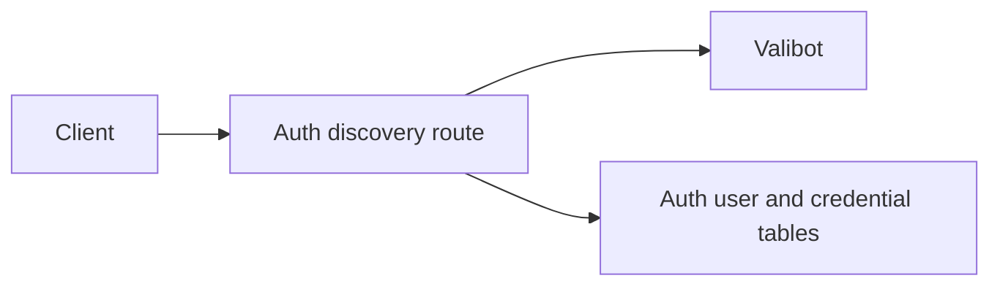
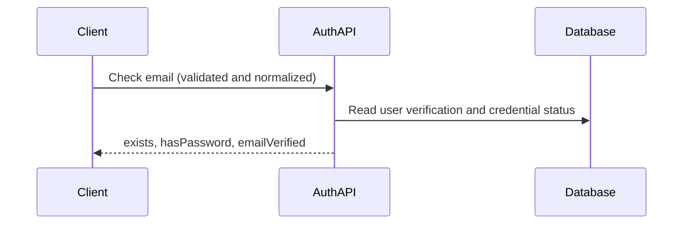

<a id="email-verification-in-identifier-discovery"></a>

# Xác minh email trong khám phá định danh

Trạng thái: đã chấp nhận

`POST /api/auth/check-email` thêm `emailVerified` từ `user.emailVerified` (sai đối với các email không xác định). Đó là gợi ý điều hướng, không phải xác thực; một trường vắng mặt có nghĩa là trạng thái không xác định. Điểm cuối công khai hiện tại và giới hạn tốc độ vẫn được giữ nguyên. Điều này cho thấy trạng thái xác minh cùng với sự tồn tại của tài khoản; không bao gồm di chuyển, bỏ qua đăng nhập hoặc thay đổi gửi email.

Trang đăng nhập web gửi người dùng hiện tại chưa được xác minh tới `/verify-email` trước khi nhập mật khẩu và duy trì sự tiếp tục của OIDC. Chính sách được hỗ trợ: trạng thái xác minh bị thiếu sẽ duy trì luồng đăng nhập hiện có trong quá trình triển khai độc lập. Xác thực vẫn thực thi xác minh.

<a id="dependencies-and-affected-files"></a>

## Các phần phụ thuộc và các tập tin bị ảnh hưởng



```text
server/
  apps/auth/src/{routes.ts,tests/routes-check-email.test.ts}
  docs/ai/adr/2026-10-10-email-verification-discovery.md
../dev-in-future/apps/ui-server-auth/src/{modules/email-password.ts,pages/sign-in.vue}
```

<a id="flow-and-verification"></a>

## Luồng và xác minh



Các thử nghiệm route bao gồm những người dùng không xác định, cả trạng thái xác minh, sự hiện diện thông tin xác thực và đầu vào không hợp lệ. Triển khai dịch vụ trước; khách hàng cũ bỏ qua trường được thêm vào. Xác thực mật khẩu vẫn có thẩm quyền. Lược đồ phản hồi Valibot từ chối đầu ra bộ điều hợp không đúng định dạng với lỗi chung 500 trước khi tuần tự hóa.
